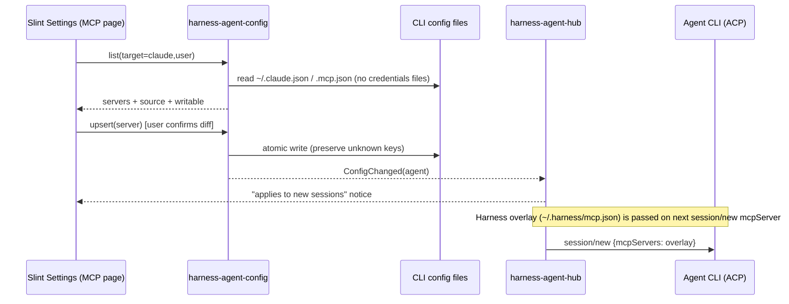
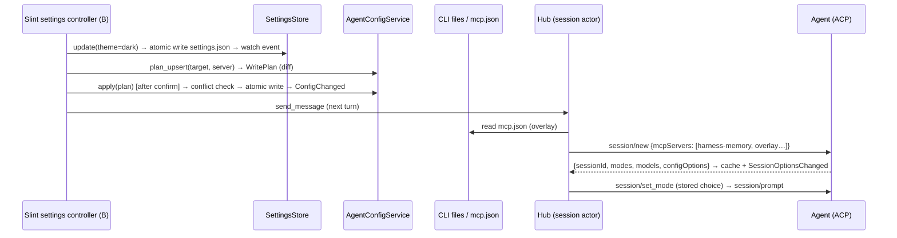
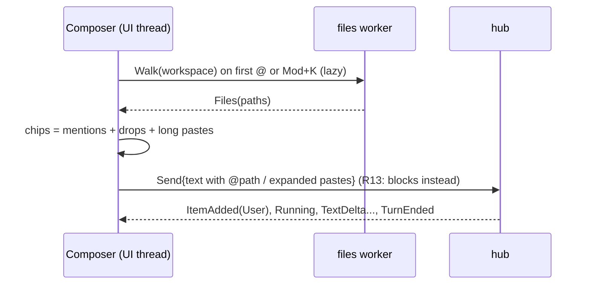

# Phase 9 — Full ZCode feature parity in the Slint app

Status: step 1 (inventory + spec), written 2026-11-02 by agent A. Documents only; no code yet.
Inputs:
- `.work/phase9/inventory.md` lists every ZCode feature with its class. That table is the source of truth for scope.
- `.work/phase9/decisions.md` holds the open user questions.

Related specs:
- `phase-8-core.md`: hub, `HarnessCore`, `WorkspaceServices`.
- `phase-8-ui.md`: Slint shell, panels.
- `phase-4-*`, `phase-5-*`, `phase-6-updater.md`: the earlier Tauri/React designs for remote, browser, plugins and updater. Their protocol and security rules still apply where reused.
- `DESIGN.md` and `CONTEXT.md` at the repo root.

## 1. Goal and product rules

1. **Nothing is silently dropped.** Every user-visible ZCode feature has one row in the inventory, classified as exactly one of:
   - (a) DONE
   - (b) PORT
   - (c) NOT-APPLICABLE
   - (d) NEEDS USER DECISION

   A sub-round is not done until every (b) row it owns is implemented and gated, or explicitly re-classified in the inventory with a reason.
2. **Harness has no own LLM agent.** ZCode features that only configure ZCode's built-in agent or account are (c). Examples: providers, API keys, Coding Plan, login, rewards, highspeed, the zcode-only tool cards and workflows.
   - When an external CLI has an equivalent concept, Harness exposes that equivalent instead. The concepts covered are MCP servers, skills, slash commands, hooks, subagents, memory/instructions, permission modes, model and effort.
   - These are configured **per CLI** (Claude Code, Codex, agy) through the CLI's own config files or through ACP (`session/new` `mcpServers`, `session/set_mode`, `session/set_model`, config options).
   - Harness never invents a parallel config that the CLI does not read.
3. **Harness is the single owner of the UI state. The CLI is the owner of the agent config.**
   - Harness settings live in `~/.harness/settings.json`. That file covers the theme, language, fonts, shortcuts, notification and tray behaviour, proxy, and the fallback order (already in the hub).
   - Harness keeps only an *overlay* for what it injects per session. For example, Harness-managed MCP servers are stored in `~/.harness/mcp.json` and passed via ACP `mcpServers`.
   - Agent config (MCP, skills, hooks, commands, subagents, memory) is read from and written to each CLI's own files: `~/.claude/*`, `<ws>/.claude/*`, `~/.codex/config.toml`, `<ws>/.codex/*`, and agy's files.
   - Every write is atomic: write a temp file, then rename. Every write preserves unknown keys and shows a diff before overwriting.
   - Harness never reads credentials files. It only shows whether a credential is present when the CLI exposes that, for example `claude auth status`.
4. **Native first; WebView and Node only on demand.**
   - Idle means the window is open, no side panels are open and no session is running. At idle the process tree is the Slint process plus nothing else.
   - **WebView** (wry/WebView2/WKWebView/WebKitGTK) runs only in a separate helper process `harness-webview`. The helper is spawned when a plugin UI, the in-app browser or a rich preview opens, and it exits ≤ 5 s after the last view closes.
   - **Node** (`sidecars/host-node`) is spawned only for features that still need the vendored ZCode TS: remote workspaces and the phone relay, if the user keeps them (see decisions). It exits when the feature is idle for 60 s.
   - Every native feature starts lazily: a worker thread or task is created on first use, like `src/panels` in Phase 8.
5. **Desktop and phone parity follow DESIGN.md.**
   - Every primary action is reachable at phone width. The Slint narrow layout covers 360–719 px.
   - Theme tokens are used only through `ui/theme/tokens.slint`.
   - UI strings are English only (user decision 2026-11-03). The gates count missing zh-CN msgids in their reports but never fail on them, and no new `.po` entries are added.
   - Remote-status colours follow the DESIGN.md mapping, with the status always shown as text.
6. **No user data leaves the machine** unless the user enables a feature that needs it: phone relay, sharing or feedback. Those features need a decision first.
   - No telemetry.
   - The logs that Harness exports contain no secrets. The exporter redacts env values and tokens.

## 2. Architecture additions

| Concern | Owner (crate / file) | Notes |
|---|---|---|
| App settings store | new `crates/harness-settings` | Typed `Settings` struct with serde defaults and a schema version. Atomic write; a watch event reaches the UI. Replaces `ui-settings.json` and migrates it on first run. |
| Per-CLI agent config | new `crates/harness-agent-config` | `ConfigTarget { agent, scope: User\|Workspace }`. Readers and writers for Claude Code `settings.json`/`.mcp.json`/`agents/*.md`/`commands/*.md`/`skills/*/SKILL.md`/hooks and for Codex `config.toml` (`[mcp_servers]`, prompts, hooks), plus agy. Each concept is a trait with per-CLI impls; an unsupported concept returns `Unsupported` and the UI greys it out. |
| ACP session options | `harness-agent-hub` (extends `phase-8-core` §) | Passes the `mcpServers` overlay on `session/new`/`session/load`. Exposes the modes, models and config options the agent advertises (`session/set_mode`, `session/set_model`, `set_config_option`) through `HarnessCore`. |
| Settings UI | `apps/harness-slint/ui/settings/*.slint` + `src/settings/*.rs` | One Slint file per page and one Rust controller per page; the nav model is built in Rust. |
| WebView helper | new `apps/harness-webview` (wry) + `crates/harness-webview-ipc` | Separate process with a JSON-lines IPC on stdio. Commands: open-view(url \| sandbox-bundle), close, eval-bridge messages. The Slint side shows a native placeholder or frame. The helper runs as a child window docked into the Side Pane where the platform allows; otherwise it is a tool window. |
| Plugins / marketplace | new `crates/harness-plugins` | Native Rust port of the catalog, install, enable and uninstall logic for **Claude Code plugin marketplaces** (the format the CLIs read). Plugin UI surfaces (MCP Apps) render in the WebView helper. |
| Platform integration | `crates/harness-platform` (extend) | Tray, OS notifications, power-save inhibit, open-with or reveal, deep-link registration, single instance, login item. |
| Updater | extract `apps/harness-app/src-tauri/src/updater/{model,store,temp_sweep}.rs` → new `crates/harness-updater` | Runtime without Tauri: signed manifest, download, verify, swap on restart. |
| Remote / phone | depends on D-REMOTE / D-RELAY | Either host-node on demand via `harness-host-control`, or a Rust port. Decided by the user. |

### 2.1 Ownership and event order for agent config (MCP example)



Rules:
- The owner of CLI-native entries is the CLI file. The owner of overlay entries is `~/.harness/mcp.json`.
- A running session is never mutated. Changes apply to the next `session/new` or `session/load`.
- Writes are idempotent: an upsert with the same content is a no-op and does not rewrite the file.

## 3. Sub-rounds and ownership (2 implementation agents)

There are two agents per round. **A** owns crates and Rust controllers. **B** owns Slint files, i18n and gates for UI flows. Each agent owns its files exclusively during the round. Cross-owner changes go through a `ui-requests.md` / `core-requests.md` note, as in Phase 8. Inventory row IDs, such as `SET-012`, are the work items.

### 9.1 Settings shell + agent config (MCP, providers→agents, skills, commands, hooks, subagents, memory)
- A: `harness-settings` (store and migration from `ui-settings.json`), `harness-agent-config` (Claude Code + Codex first, agy where a format exists), the hub ACP `mcpServers` overlay, and `list_modes`/`list_models`/`set_mode`/`set_model` in `HarnessCore`.
- B: the settings shell with nav groups (Basics / Agent capabilities / Data); full UI contract in §6. Pages:
  - General, Appearance, Shortcuts (rebindable; stored in settings), Agents (fallback order, per-agent install/auth status, default mode/model per agent).
  - Instructions (CLAUDE.md / AGENTS.md editor per scope), Memory (view `MEMORY.md` + hub memory).
  - MCP servers, Skills, Commands, Hooks, Subagents: list, form and JSON editors per CLI target.
  - Archive and Projects management.
- Gate `phase9-settings` (UI half: §6.7):
  - Isolated HOME with fake `~/.claude`/`~/.codex` fixtures.
  - Every page opens through MCP automation.
  - Each field round-trips: the UI changes it, the file on disk changes with unknown keys preserved, and a restart shows the same value.
  - The MCP overlay is visible in the fake agent's recorded `session/new` params.
  - Shortcut rebind and conflict detection work.
  - zh-CN has no missing strings.
  - Idle RAM ≤ 50 MB after closing settings.

#### 9.1.1 Crate `harness-settings` (owner A)

File: `<data dir>/settings.json` (data dir = §9.1.2). Single owner: `SettingsStore` (one per process; the UI
creates it, nothing else writes the file).

```jsonc
{
  "schemaVersion": 1,
  "general": {
    "language": "system",            // "system" | "en-US" | "zh-CN"           GEN-001
    "terminal": { "inheritSystemProfile": true, "fontFamily": null, "fontSize": 13, "shell": null }, // GEN-004..006
    "proxy": { "httpProxy": null, "noProxy": null, "caCertPath": null },     // GEN-009..011 (env for CLIs, 9.5)
    "hardwareAcceleration": true,     // GEN-012
    "followUp": "queue",              // "queue" | "steer"                       GEN-019
    "showReasoning": true, "showTodos": true,                                  // GEN-022/023
    "groupExploration": true, "groupTerminal": true, "groupFileChanges": true  // GEN-024..026
  },
  "appearance": { "theme": "system", "uiFontSize": 14, "codeThemeLight": "github-light",
                  "codeThemeDark": "github-dark", "lineNumbers": true, "wrapLines": false, "codeFontSize": 13,
                  "nativeFrame": true },  // OS title bar instead of the custom borderless chrome; startup only
  "notifications": { "taskDone": true, "sound": true, "closeToTray": false, "keepAwake": false }, // 9.5 rows
  "updates": { "previewChannel": false, "autoDownload": false },                                  // 9.5 rows
  "shortcuts": { "<action-id>": "Mod+Shift+K" },   // overrides only; defaults live in the UI keymap
  "agents": { "<agent-id>": { "enabled": true, "defaultMode": null, "defaultModel": null } },     // AGT-002/007
  "memory": { "workspaceMemoryEnabled": true }     // MEM-001
}
```

- Typed `Settings` struct, every field has a serde default, so a missing or partial file yields defaults.
  `schemaVersion` > 1 (written by a newer Harness) → load read-only (`SettingsError::NewerSchema`), never
  overwritten.
- `appearance.nativeFrame` (default `true`, Settings → Appearance → "Use Windows title bar") selects the OS
  window frame at startup: the custom minimize/maximize/close buttons, the edge resize handles and the custom
  title-bar drag are hidden/disabled, and Windows handles drag, snap, Aero resize and drag-to-restore. winit
  cannot reliably add or remove decorations on a live window, so the row is labelled "restart to apply" and
  only the value read at launch is used.
- **Unknown keys are preserved**: a save reads the current file into an order-preserving JSON tree, deep-merges the
  typed values over it (typed keys win, `null` included; unknown keys at any depth stay in place) and writes it.
- **Atomic write** (`fsx::write_atomic`): temp file in the same directory → flush + `sync_all` → rename over the
  target. A save whose merged content equals the file on disk is a no-op (no write, no event).
- **Change event**: `SettingsStore::subscribe() -> watch::Receiver<Arc<Settings>>`. Fired after every successful
  save and by `reload()` when the file changed on disk (content compare). No file watcher thread (RAM rule §4).
- **Migration** (`SET-009`): when `settings.json` does not exist and `ui-settings.json` (Phase 8 UI prefs:
  `{ "theme": "system"|"light"|"dark", "language": "en-US"|"zh-CN" }`) exists, the store takes theme and
  language from it and writes `settings.json`. The old file is left untouched (idempotent, rollback-safe).
- Shortcut conflicts: `shortcuts::conflicts(defaults, overrides) -> Vec<Conflict { accelerator, actions }>` with
  normalised accelerators (`Mod` = Ctrl on Windows/Linux, Cmd on macOS; modifier order ignored, case-insensitive).

API (Rust):

```rust
SettingsStore::open(data_dir: &Path) -> Result<SettingsStore, SettingsError>   // migrates, reads
store.get() -> Arc<Settings>
store.update(|s: &mut Settings| ...) -> Result<SaveOutcome { written: bool }, SettingsError>
store.reload() -> Result<bool /*changed*/, SettingsError>
store.subscribe() -> tokio::sync::watch::Receiver<Arc<Settings>>
```

#### 9.1.2 Data dir relocation (decision 17 = A)

- **Base dir** = `HARNESS_HOME` if set, else `~/.harness`. **Data dir** = the base dir, unless
  `<base>/relocated.json` = `{ "dataDir": "<abs path>", "movedAt": <unix ms> }` points to a directory that holds the
  marker `<dataDir>/.harness-data`. A pointer whose target lost its marker is ignored (warning) → base dir is used.
- `relocation::resolve_data_dir(base) -> DataDirInfo { base, data_dir, relocated }` is the only resolver. The UI
  resolves once at startup and hands the result to `SettingsStore`, the hub (`HubConfig.home`) and everything else.
- `relocation::relocate(base, current, target, progress) -> RelocationReport`. **Must run while the hub is stopped**
  (the UI does it during restart: shut down hub → relocate → start hub on the new dir). Steps:
  1. Validate: absolute target; not inside the current data dir and vice versa; target missing or empty (or our own
     unfinished attempt, see 2).
  2. Write `<target>/.harness-relocating` (marker of an unfinished copy). An existing target that contains only our
     marker plus copied files is cleared first, so a retry after an interruption starts clean.
  3. Copy every file of the current data dir except `relocated.json`, `*.lock`, `tmp/`, temp files.
  4. Verify: every copied file is compared byte for byte with its source. Any mismatch → error, pointer untouched.
  5. Write `<target>/.harness-data` (marker), remove `.harness-relocating`.
  6. **Switch**: write the pointer atomically (`relocated.json`, or delete it when the target is the base dir).
  7. Delete the copied source files (list kept in `<base>/relocated.cleanup.json` until done, so an interrupted
     cleanup resumes on the next `resolve_data_dir`).
- Interrupted before 6 → the pointer still names the old dir; the target holds `.harness-relocating` and is cleared
  on the next attempt. Interrupted after 6 → the new dir is used; leftover cleanup resumes. No state where the
  pointer names an unverified copy.

#### 9.1.3 Crate `harness-agent-config` (owner A)

```rust
enum AgentKind { ClaudeCode, Codex, Agy }          // serde "claudeCode" | "codex" | "agy"; hub ids claude-code|codex|agy
enum Scope { User, Workspace }
struct ConfigTarget { agent: AgentKind, scope: Scope }
struct ConfigPaths { home, claude_dir, claude_json, codex_home, gemini_dir, workspace: Option<PathBuf> }
```

`ConfigPaths::from_env(workspace)`: `CLAUDE_CONFIG_DIR` (then `.claude.json` lives inside it) else `~/.claude` +
`~/.claude.json`; `CODEX_HOME` else `~/.codex`; `~/.gemini` for agy. Tests and gates always pass isolated paths.

One trait per concept, implemented by `ClaudeCodeConfig`, `CodexConfig`, `AgyConfig`; the facade
`AgentConfigService` returns `&dyn McpConfig` etc. per agent. An unsupported concept/scope returns
`ConfigError::Unsupported { agent, concept, reason }`; `service.support(target, concept) -> Support` tells the UI
to grey it out without calling.

| Concept | Claude Code | Codex | agy |
|---|---|---|---|
| MCP (user) | `<claude_json>` `mcpServers` (`type` stdio/sse/http, `command`, `args`, `env`, `url`, `headers`); toggle: unsupported | `<codex_home>/config.toml` `[mcp_servers.<n>]` (`command`, `args`, `env`, `url`, `http_headers`, `enabled`, `startup_timeout_sec`, `tool_timeout_sec`); stdio + http | `<gemini_dir>/config/mcp_config.json` `mcpServers` (`command`, `args`, `env`, `serverUrl`\|`url`, `headers`, `disabled`) — **unverified format** (phase-8-core §6.5) |
| MCP (workspace) | `<ws>/.mcp.json` `mcpServers`; enable/trust: `<ws>/.claude/settings.local.json` `enabledMcpjsonServers` / `disabledMcpjsonServers` / `enableAllProjectMcpServers` | `<ws>/.codex/config.toml` | `<ws>/.agents/mcp_config.json` |
| Skills | `<claude_dir>/skills/<n>/SKILL.md`, `<ws>/.claude/skills/<n>/SKILL.md`; toggle unsupported | `<codex_home>/skills/<n>/SKILL.md`, `<ws>/.codex/skills/…` | Unsupported |
| Commands | `<claude_dir>/commands/**/*.md`, `<ws>/.claude/commands/**/*.md` (`a/b.md` = `a:b`); front matter `description`, `argument-hint`, `model`, `allowed-tools` | user only: `<codex_home>/prompts/*.md` (`description`, `argument-hint`) | Unsupported |
| Hooks | `<claude_dir>/settings.json`, `<ws>/.claude/settings.json` `hooks.<Event>[] { matcher, hooks[] { type:"command", command, timeout, statusMessage, async } }` | Unsupported (format unverified) | Unsupported |
| Subagents | `<claude_dir>/agents/*.md`, `<ws>/.claude/agents/*.md` (`name`, `description`, `tools`, `model`, `color`, body = system prompt); toggle unsupported | Unsupported | Unsupported |
| Instructions | `<claude_dir>/CLAUDE.md`; `<ws>/CLAUDE.md`, `<ws>/.claude/CLAUDE.md`, `<ws>/CLAUDE.local.md` | `<codex_home>/AGENTS.md`; `<ws>/AGENTS.md` | `<gemini_dir>/GEMINI.md`; `<ws>/GEMINI.md`, `<ws>/AGENTS.md` |

Instructions: `candidates(target)` lists the fixed files above (with `exists`, `size`); `read`/`plan_write` accept only
a path from that list (the user picks it in the UI). Harness itself never writes them otherwise (phase-8-core §1.8).

**Write protocol (every concept):** `plan_*(…) -> WritePlan { changes: Vec<FileChange { path, op: Write|Delete|RemoveDir,
diff, no_op }> }` computes the new file content in memory and a unified diff (3 lines context) for the preview.
`service.apply(&plan) -> ApplyOutcome { written: Vec<PathBuf> }` re-checks that every file still has the content the
plan was computed from (`ConfigError::Conflict` otherwise), writes atomically (`fsx::write_atomic`), and broadcasts
`ConfigChanged { agent, concept, scope, paths }`. A no-op change is skipped (file untouched, not in `written`).
Same-content detection is semantic for JSON (parsed tree equal), textual for TOML (toml_edit keeps formatting) and
markdown. JSON files keep key order and indentation (order-preserving tree, own indent detection); TOML keeps
comments and unknown keys (toml_edit edits tables in place). Unknown per-entry keys come back as `extra` and are
written back as given (form and raw-JSON editors round-trip them).

**Secrets.** Never opened: `.credentials.json`, `credentials.json`, `auth.json`, `oauth_creds.json`, `*.key`, `.env*`
(`fsx` refuses them; crate test). Config files that may contain secrets (`.claude.json`, `config.toml`) are parsed,
only the concept subtree is returned, nothing is logged. Diff previews mask values of `env`, `headers`,
`http_headers` and of keys matching `key|token|secret|password|credential|auth` as `"••••"`.
Auth state: `trait AuthProbe { fn probe(&self, agent) -> AuthState { Present | Absent | Unknown } }`; the default
`FileExistenceProbe` checks only that the CLI's credential file exists (metadata, never read); gates inject a
`StaticProbe`.

**Copy between CLIs** (MCP-004, SKL-003, COM-002): `service.plan_copy_mcp(from, to, name)`,
`plan_copy_skill`, `plan_copy_command` → a normal `WritePlan` on the destination.

#### 9.1.4 Harness MCP overlay (MCP-022)

`<data dir>/mcp.json` = `{ "mcpServers": { "<name>": { "type": "stdio"|"http"|"sse", "command", "args", "env", "url",
"headers", "enabled": true, "agents": ["codex"] } } }` (`agents` empty/missing = all agents). Owner:
`harness_agent_config::overlay::Overlay` (same plan/apply protocol). The hub reads it fresh on every ACP
`session/new` and `session/load` and appends the enabled entries after `harness-memory` (reserved name, overlay
entries with that name are skipped). ACP shape: stdio `{ name, command, args, env: [{name,value}] }`; http/sse
`{ type, name, url, headers: [{name,value}] }`, sent only when the agent advertised
`agentCapabilities.mcpCapabilities.http|sse` (otherwise skipped, logged at debug). An unreadable overlay never
fails a turn (warning, memory server only). A running session is never changed: edits apply to the next
`session/new`/`session/load`.

Built-ins (user request 2026-11-08): `harness-memory` (every session), `harness-delegate` (when the delegate server
runs) and `harness-computer` (self-exe helper mode) are added by the hub, never stored in the overlay. Their names are
reserved: the overlay refuses to save them and the hub skips overlay entries with these names. The Harness tab lists
them first as read-only rows tagged "Built-in" (no toggle/edit/delete).

Import (user request 2026-11-08): the Harness tab has an "Import" chooser — From Claude Code (`~/.claude.json`
top-level `mcpServers`), From Codex (`config.toml` `[mcp_servers]`), From agy (`mcp_config.json`), or All. The
user-scope list of each source is read with the existing per-CLI readers; the result is one `WritePlan` on the
overlay (`AgentConfigService::plan_import_mcp`), shown as a diff and applied on confirm. Rules: names already in the
overlay, names earlier in the same import and `harness-*` names are skipped; a disabled source entry stays disabled
(`enabled: false`), every other entry is `enabled: true`; `agents` stays empty (all agents); Codex-only timeouts and
unknown keys are dropped. A source whose file is unreadable is skipped (counted, its content is never logged); when
every chosen source fails the import fails. After apply the status line shows "Imported X, skipped Y". Nothing to
import → no diff, only the status line.

#### 9.1.6 Harness skills (user request 2026-11-04)

Harness has its own skills, shared by every agent in Harness (Claude Code, Codex, agy and the API provider agents).
Together with the MCP overlay (§9.1.4) this is the Harness-owned set: it does not depend on any CLI's config.

- **Store:** `<data dir>/skills/<name>/SKILL.md` plus any other files in that folder, the same layout as Claude Code
  skills. User scope only. Owner: `HarnessOverlayConfig` (`SkillsConfig`), same plan/apply protocol and diff
  confirmation as every other entry. `support_of(Harness, Skill)`: user scope, no on/off.
- **Settings:** Settings → Skills shows the **Harness** target next to the CLI tabs (as MCP Servers does). Skills
  and MCP server rows of a CLI tab get a **Copy to Harness** action: a normal `plan_copy` to `{Harness, User}`.
- **Copy of a skill** (any source and destination): writes `SKILL.md` and also copies the other files of the source
  folder, recursively, keeping relative paths: UTF-8 files up to 1 MiB each, at most 200 files; dot-folders,
  binary and larger files are skipped. All writes are one plan, shown in the diff before anything is written.
- **Slash list:** `list_commands` adds every Harness skill for every agent, including agents without a CLI kind,
  with `source: Harness`, `description` from the front matter and `path` = its `SKILL.md`. A Harness skill wins
  over an agent, user or workspace command of the same name (that entry is hidden).
- **Use:** when a turn's user text is `/<name>` or `/<name> <input>` and `<name>` is a Harness skill (read fresh
  when the prompt is built), the hub sends, in place of the user text block, one text block:
  `<harness-skill name="<name>" dir="<absolute skill folder>">` + the `SKILL.md` body (front matter removed) +
  `</harness-skill>`, a line saying the folder's other files can be read when the skill refers to them, then
  `Follow the Harness skill "<name>" above for this request: <input>` (`(no extra input)` when empty). The turn
  keeps the user's text as typed. Skill text never starts the prompt with `/`, so a CLI never treats it as one of
  its own commands. A name that is not a Harness skill is sent unchanged (§9.2.1 rule).

#### 9.1.5 Hub: modes, models, config options (API 0.3.0, additive)

New `HarnessCore` methods (default impls return `ApiError::Internal("… not supported")`):

| Call | Result |
|---|---|
| `list_modes(session_id)` | `SessionModes { agent, current: Option<String>, available: Vec<ModeInfo { id, name, description }>, known }` |
| `list_models(session_id)` | `SessionModels { agent, current, available: Vec<ModelInfo { id, name, description }>, known }` |
| `list_config_options(session_id)` | `SessionConfigOptions { agent, options: Vec<ConfigOption { id, name, description, category, current, values: Vec<ConfigValue { value, name, description }> }>, known }` |
| `set_mode(session_id, mode_id)` / `set_model(session_id, model_id)` / `set_config_option(session_id, config_id, value)` | `()` |

- Everything is about the session's **active agent**. Source of `available`: what the agent advertised in its last
  `session/new`/`session/load` response (`modes`, `models`, `configOptions`) or `current_mode_update` /
  `config_option_update` notifications; cached per agent (store `settings` key `agent_options:<id>`) so the
  pickers work before the first turn after a restart. `known = false` when the agent never advertised anything.
- `set_*` validates the id against the advertised list (when known) → `InvalidArgument`; stores the choice per
  (session, agent) in table `session_prefs` (additive `CREATE TABLE IF NOT EXISTS`); the value shows as `current` at
  once. Applied: before the next prompt of that session (the session actor awaits each ACP
  `session/set_mode` / `session/set_model` / `session/set_config_option` after reuse/`session/load`/`session/new`
  and before `session/prompt`); there is no separate apply while idle, which keeps one ordered write path. Only
  values that differ from what the native session already has are sent. A running turn is never changed. An agent
  refusing a set call is logged (`warn`) and the turn proceeds. A `current_mode_update` sent by the agent itself
  becomes the session's choice.
- `agent_options(agent_id) -> AgentOptions { modes, models, config }`: the cached lists of one agent without a
  session (settings Agents page); `current` = configured default, else what the agent last reported.
  Probe (user report 2026-11-03: the Agents page dropdowns were empty for an agent that had never run): when the
  cache of an installed agent holds nothing (no modes, models or config), `agent_options` first asks the agent once:
  acquire the pooled process, `session/new { cwd: <HARNESS_HOME>/probe, mcpServers: [] }` (no prompt is ever
  sent, no Harness session is created), merge the response through the cache's single write path
  (`record_advertised`), release. A failed or empty probe returns the empty lists; the UI then shows an empty
  state in the dropdown ("<agent> reports its options after its first chat") instead of an empty menu. At most
  one probe per agent runs at a time; it is not retried until the next `agent_options` call.
  Agent card layout (user request 2026-11-03): each agent card's header row holds the name, version, "Installed"
  and sign-in tags and the enable switch. Default mode / model / reasoning effort, launch command, connection
  test (latency shown next to the button) and environment rows render only while the agent is enabled; a
  disabled agent shows the header row alone.
  Enable switch → composer (user report 2026-11-04: agents switched off still appeared in the chat agent
  picker): the composer agent picker and its usage list show only enabled agents that are installed (an agent
  whose CLI or adapter is missing is left out; an exhausted agent stays, disabled, with its reset time), in
  fallback order, numbered by their position in that filtered list. The Settings fallback order still lists every
  enabled agent. Without an open session, when the selected agent is disabled the
  selection moves to the first enabled, available agent of the fallback order (none: unchanged). An open session
  whose agent is disabled keeps it until the user picks another one; the picker then has no checked row.
- Defaults (AGT-007): `HubConfig.agent_defaults: HashMap<AgentId, AgentDefaults { mode, model, config }>` (the UI
  fills it from settings `agents.<id>`; `default_effort` → `config["effort"]`); applied to a fresh native session
  for every value the session has no own choice for.
- New event `EventKind::SessionOptionsChanged { agent }` (session-scoped) after a set or a new advertisement; the
  UI re-reads the lists.
- Fake agent: advertises modes `default|plan|acceptEdits`, models `fake-small|fake-large`, option `effort`
  (`low|medium|high`); implements the three set methods; `[[options]]` answers with its current values;
  logs `mcpServers` of every new/load and every set call.

#### 9.1.5a Hub: agents overview, memory, projects, archive (API 0.4.0, additive; B requests R3–R5)

New `HarnessCore` methods (default impls return `ApiError::Internal("… not supported")`). New error variants
`ApiError::Conflict` (file changed since the plan) and `ApiError::Busy` (session has a running, queued or paused
turn or a pending permission). New global event `EventKind::SessionsChanged` after any archive / unarchive / delete /
project remove / restore, so lists re-read.

| Call | Result / rule |
|---|---|
| `agents_overview()` | `Vec<AgentOverview { id, display_name, installed, command_path, install_hint, version, auth: Present\|Absent\|Unknown, login_hint, runtime, quota }>`. `installed` = PATH lookup (never runs the CLI). `version` = `agentInfo.version` of the last ACP `initialize` (adapter version; cached in store key `agent_info:<id>`), `None` until the agent ran or was tested. `auth` = injected `AuthProbe` (`HubConfig.auth_probe`, default file/env existence, never reads secrets) for the agent's CLI kind (`HubConfig.agent_kinds`, default by id `claude-code`/`codex`/`agy`; other ids `Unknown`). |
| `test_agent(agent)` | `AgentTestResult { agent, ok, latency_ms, agent_name, version, error }`: spawns a separate process (not the pool), ACP `initialize` with a 20 s timeout, stops it. Records `version`. Gates run it against the fake agent only. |
| `memory_files()` | `Vec<MemoryFileInfo { scope, path, exists, bytes, modified_ms }>`: Global + Project of every listed (not removed) project. |
| `memory_doc(scope)` | `MemoryDoc { scope, path, content, exists }`. |
| `memory_plan(scope, content)` | `MemoryPlan { scope, path, base, content, diff, no_op }`; `diff` unified (3 lines), `base` = fingerprint of the current file. |
| `memory_apply(plan)` | Under the MEMORY.md lock (the single write path shared with the MCP server): current fingerprint ≠ `base` → `Conflict`, file untouched; else atomic write + `MemoryChanged`. `no_op` → nothing. |
| `list_projects(ListProjects { query, removed })` | `Vec<ProjectInfo { workspace_key, workspace_path, sessions, archived, last_used, unused, removed_at }>`. A project = a workspace key with sessions or a row in table `projects`. `unused` = no session updated in 30 days. `removed = true` lists removed projects (restore list). |
| `remove_projects(keys, delete_data)` | Marks removed (`projects.removed_at`); their sessions leave `list_sessions` / `list_archived` (unless filtered by that key). `delete_data` also deletes every session of the project from the store (all tables) — refused with `Busy` (nothing changed) if any is busy; workspace files (incl. `<ws>/.harness/MEMORY.md`) are never deleted. |
| `restore_projects(keys)` | Clears `removed_at` (undo). After `delete_data` only the empty project comes back. A new session in a removed project also restores it. |
| `archive_sessions(ids)` | Sets `sessions.archived_at`; every session must be idle, else `Busy` and nothing changes; the actors are unloaded. Archived sessions leave `list_sessions`; `open_session` still works; `send_message` to an archived session unarchives it. |
| `list_archived(ListArchived { query, workspace_key, sort: ArchivedNewest\|ArchivedOldest\|Title, offset, limit ≤ 200 })` | `ArchivePage { rows: Vec<ArchivedSession { summary, archived_at }>, total, has_more }`. |
| `unarchive(selection)` / `delete_archived(selection)` | `selection = Sessions(ids) \| Project(workspace_key)` (all archived of that project). Return the count changed. Delete only touches archived sessions (others are skipped), removes all their rows. |

Store: additive `ALTER TABLE sessions ADD COLUMN archived_at INTEGER` (applied when missing) and
`CREATE TABLE IF NOT EXISTS projects(workspace_key PRIMARY KEY, workspace_path, removed_at)`; `user_version` stays 1.
Single owners: the store for rows; a session actor for its live state — archive/delete first asks the actor to retire
(`SessionCmd::Retire`: refuses while busy, else exits) while the hub holds the actor registry lock, so no actor is
re-spawned during the change.

UI core channel (`apps/harness-slint/src/core/mod.rs`, R5): `Command::AgentsOverview` → `Event::AgentsOverview(rows)`;
`Command::TestAgent(id)` → `Event::AgentTested { .. }` then a fresh `Event::AgentsOverview`; memory / projects /
archive calls go through `Command::Settings(SettingsCall)` whose variants carry a `oneshot` reply, so the settings
worker awaits results without new events. The fake core answers from in-memory fixtures.

#### 9.1.6 Ownership and event order



#### 9.1.7 Acceptance (core half of `scripts/e2e/phase9-settings.mjs`, binary `harness-core-gate phase9-settings`)

Isolated home (`installIsolatedHome`): fake `.claude` (`CLAUDE_CONFIG_DIR`), `.codex` (`CODEX_HOME`), `.gemini` and a
workspace, all seeded with unknown keys, TOML comments and dummy secrets (`.credentials.json`, `auth.json`,
`oauth_creds.json`, `primaryApiKey` in `.claude.json`, a bearer token and an MCP env secret in `config.toml`).

1. `settings_roundtrip`: migration from `ui-settings.json`, update → file has the value + unknown keys, reopen
   shows it, same-value update is a no-op (mtime unchanged), change event fired.
2. `concept_roundtrip`: for every supported (agent, scope, concept) cell: create/update → re-read equal, unknown keys
   and TOML comments preserved, same-content plan is `no_op`, delete; every unsupported cell returns `Unsupported`.
3. `conflict`: a plan applied after the file changed → `Conflict`, file untouched.
4. `diff_masking`: previews never contain the env/bearer secrets.
5. `overlay_session_new`: `mcp.json` with one stdio + one http entry → fake agent's logged `session/new` has
   `harness-memory` + the stdio entry (http skipped: not advertised); an edit while a session's native session exists
   does not change it; the next new session sees it.
6. `modes_models`: lists after first turn, `set_mode`/`set_model`/`set_config_option` → fake agent logs the calls and
   `[[options]]` reports the values; invalid id rejected; set during a running turn applied only to the next turn;
   persisted across hub restart.
7. `relocation`: relocate data dir → pointer written, files verified, hub starts on the new dir with sessions intact;
   simulated interruption (marker left, no pointer) → old dir still used, retry succeeds.
8. `agents_overview`: fake agents mapped to CLI kinds → `installed`, `auth = Present` from fixtures (existence
   only), `version` unknown before and `0.1.0` after `test_agent` (fake agent, `ok`, latency measured); a missing
   program → `installed = false`, test fails with an error, no process left.
9. `memory_admin`: plan → diff + apply → file content + `MemoryChanged`; same content → `no_op`; a change on disk
   between plan and apply → `Conflict`, file untouched; `memory_files` lists global + project.
10. `projects`: list with counts; remove → gone from `list_projects` and `list_sessions`, listed as removed;
    restore → back; remove with data while a turn runs → `Busy`; after it ends → sessions deleted, store rows gone.
11. `archive`: archive a busy session → `Busy`; archive idle → leaves `list_sessions`, in `list_archived` (paging,
    query, project filter, sort); unarchive by id; `Project` selection unarchive/delete; send to an archived
    session unarchives it; `SessionsChanged` emitted.
12. `secrets`: the script scans gate stdout/stderr, every file under the data dirs and the fake agent log for every
   fixture secret string → none found. Auth probe reports `Present` for fixtures (existence only).

### 9.2 Chat and workspace parity (composer, timeline, sidebar)
- A: core APIs for:
  - fork, edit-and-resend, retry, rewind (via turn snapshots from 8.2), rename/pin/archive/delete session, groups, projects, and find in session.
  - attachments (ACP content blocks: image/resource), `@` file resolution, slash command list (CLI-advertised `available_commands` + `harness-agent-config` commands).
  - plan, todo and usage data from ACP updates.
- B, the Slint UI:
  - command center (Mod+K), find (Mod+F), mention and slash popups, attachment chips with drag and drop and paste.
  - expandable tool cards (diff, command output, MCP params), thinking blocks, message actions.
  - queue edit, reorder and steer; mode/model/effort pickers fed by agent capabilities; permission dialog with allow-once/always.
  - status panel (todo/plan/background), context meter, changed-files summary with undo.
  - task sidebar actions, groups, archive, projects, header (open in editor, reveal), prev/next and back/forward navigation, zoom, error banners.
- Gate `phase9-chat`: driven by the fake agent with scripted plan/todo/tool/diff/permission/usage updates. Each row in the inventory's Chat/Sidebar areas has at least one assertion. Idle RAM ≤ 50 MB.

#### 9.2.1 Hub API 0.5.0 (A; additive, written 2026-11-03)

All new `HarnessCore` methods default to `ApiError::Internal("… not supported")`. Every new field on an existing
type is `#[serde(default)]`, so 0.4 payloads still parse. New types live in `harness-core-api/src/chat.rs`.
"Busy" below means the session has a running, queued or paused turn or a pending permission
(`ApiError::Busy`; nothing changed).

**Session organisation** (SB-003/006/007/008, GRP-001/002/005). `SessionSummary` gains `pinned: bool`,
`group_id: Option<String>`, `order: i64` (sort key inside the sidebar section, larger = higher; "move to top"
raises it), `unread: bool`, `forked_from: Option<ForkOrigin { session_id, turn_seq }>`,
`imported_from: Option<String>` (`zcode:<id>` / `claude-code:<id>`).

| Call | Rule |
|---|---|
| `rename_session(id, title)` | Trimmed, 1–200 chars, else `InvalidArgument`. Through the session actor (owner of `row.title`). `SessionUpdated`. |
| `set_pinned(ids, pinned)` | Store column `pinned_at`; `SessionUpdated` per session. |
| `set_unread(id, unread)` | `unread = true`: mark unread. `false`: mark read (sets `read_at = now`, clears the mark). The UI calls `set_unread(id,false)` when it shows a session and again on `TurnFinished` of the shown session. `unread` = mark set OR a turn finished after `read_at`. New sessions start read. |
| `list_groups()` | `Vec<SessionGroup { id, name, color, position }>` by `position`. |
| `create_group(name, color)` | `SessionGroup`; name trimmed 1–60 chars. `color: GroupColor = gray\|red\|orange\|yellow\|green\|blue\|purple` (GRP-002, 7 colours; the UI maps them to theme tokens). Appended last. |
| `update_group(UpdateGroup { id, name?, color? })` | `NotFound` for unknown ids. |
| `delete_group(id)` | Members become ungrouped (sessions are never deleted). |
| `reorder_groups(ids)` | Must be a permutation of all group ids, else `InvalidArgument`. |
| `move_sessions(ids, group_id: Option)` | Sets the group (`None` = ungrouped) and puts them on top of that section in the given order (`order = max(now_ms, max(sort_order) + 1) + n…`, so a second move within the same millisecond still lands on top). Also the "move to top" action (same group). |

Every group mutation emits the global `EventKind::GroupsChanged`; a session move emits `SessionUpdated`.

**Turn actions** (MSG-002/003/004/005/007, CHG-002/003, TL-016). All refuse with `Busy`. "Truncate at N" removes
turn N and every later turn (rows in all turn tables, snapshots included), drops all native agent handles of the
session (the next turn starts fresh native sessions and gets the seed block of the remaining turns, so no agent
keeps the removed context), and emits `TurnsRemoved { from_seq }` (session-scoped) then `SessionUpdated`.

| Call | Rule |
|---|---|
| `fork_session(ForkSession { session_id, up_to_turn?, title? })` | New session in the same workspace with copies of the finished turns up to and including `up_to_turn` (default all); new turn ids, attempts/tool calls/permissions copied, snapshots not copied. No native handles (fresh agents get the seed block). Title default `"<title> (fork)"`. `forked_from` set. `SessionCreated`. A busy source is allowed (only finished turns are copied). |
| `rewind_session(Rewind { session_id, turn_id, restore_files })` | Truncate at the turn. Returns `RewindResult { removed_turns, user_text, context, files: Option<FileRestoreReport> }`; the UI puts `user_text`/`context` back into the composer. `restore_files`: the workspace goes back to the `before` tree of that turn for every path changed by the removed turns (see file rules). |
| `edit_and_resend(EditResend { session_id, turn_id, text, context?, agent?, restore_files })` | Atomic in the actor: rewind (as above) then send `text` (context default = the old turn's). Returns `SendAccepted`. |
| `retry_turn(Retry { session_id, turn_id, agent?, restore_files })` | Only the last turn (else `InvalidArgument`); rewind then resend the same text and context. |
| `plan_file_changes(session_id, turn_id, direction: Undo\|Reapply)` | `FileChangePlan { turn_id, direction, available, reason, files: Vec<PlannedFile { path, action: Restore\|Delete, safe, reason }> }`. |
| `apply_file_changes(ApplyFileChanges { session_id, turn_id, direction, paths?, include_unsafe })` | `FileRestoreReport { applied, skipped: Vec<(path, reason)> }`. `paths = None` = all. Unsafe files are skipped unless `include_unsafe`. Marks `TurnDiff.undone` (undo) / clears it (reapply). Emits `FilesRestored { turn_id, direction }`. |

File rules (single source: git trees of the 8.2 snapshots; no second copy of file contents):
- Undo: `target = before`, `expected = after`. Reapply: the reverse. Rewind: `target = before` of the first removed
  turn, `expected = after` of the last removed turn that has one; turns without snapshots make it `available = false`.
- Changed paths = `git diff --name-only --no-renames target expected` (relative).
- A path is **safe** when the workspace file still equals `expected` (`git hash-object` = blob in `expected`, or
  both absent). Otherwise unsafe with reason `modified since the turn` / `deleted since the turn` /
  `created since the turn`.
- Restore writes the `target` blob (`git cat-file blob`) atomically (temp + rename); `Delete` when the path is not
  in `target`. Never touches paths outside the changed list, never runs `git checkout`/`reset`, never changes the
  index or HEAD.
- Refused with `Busy` while the session is busy (an agent could be writing).

**Find in session** (FIND-*): `find_in_session(FindInSession { session_id, query, case_sensitive, limit ≤ 500 })`
→ `Vec<FindHit { turn_id, seq, field: User|Assistant|Tool, start, len, snippet }>`; `start`/`len` in chars of that
field; tool hits search titles. Reads the actor snapshot (includes the running turn's streamed text).

**Attachments and mentions** (ATT-001/004/005/006, MEN-002/003). `SendMessage`/`EditResend` gain
`context: Vec<ContextItem>`:

```text
ContextItem = File { path } | Folder { path } | Image { path?, data_base64?, mime } | Text { title?, text }
            | Session { session_id }
```

- Paths are absolute or workspace-relative. Validated at send (`InvalidArgument` with the item index): ≤ 10 items,
  file exists, image ≤ 5 MB with mime `image/png|jpeg|gif|webp`, pasted text ≤ 1 MB, total ≤ 20 MB, a session
  mention must exist and differ from the target.
- Image data is written to `<home>/attachments/<turn_id>/<n>.<ext>` and the stored item keeps only the path
  (the store never holds base64). `TurnView.context` shows the stored items.
- Resolution happens when the prompt is built (per agent, so failover adapts). It uses the agent's
  `promptCapabilities` from `initialize`:
  - text file ≤ 256 KB → `resource` (embedded text) when `embeddedContext`, else `resource_link`;
  - larger or binary file → `resource_link`;
  - folder → `resource_link` with `mimeType: inode/directory`;
  - image → `image` block when `image`; otherwise a text note `[image <name> omitted: <agent> does not accept
    images]` (and `resolve_context` reports `unsupported` so the UI warns before sending);
  - pasted text → `text` block `<pasted title="…">…</pasted>`;
  - session mention → `text` block with that session's transcript (user/assistant text, newest kept, ≤ 32 KB).
- `resolve_context(session_id, items)` → `Vec<ResolvedItem { index, ok, error?, block_kind, bytes, label }>`
  validates chips without sending.
- `mention_candidates(MentionQuery { session_id, query, kinds: files|folders|sessions, limit ≤ 50 })` →
  `Vec<MentionCandidate { kind, label, detail, item }>`. Files/folders come from the injected file source
  (`HubConfig.file_search`); sessions from the store (title match, archived excluded, current excluded).

**Slash commands** (MEN-009/010/013). `list_commands(session_id)` → `CommandList { agent, known, commands:
Vec<SlashCommand { name, description, input_hint, source: Agent|User|Workspace|Harness, path? }> }`:
- `Agent`: the agent's last ACP `available_commands_update` (cached per agent, store key `agent_commands:<id>`,
  accepted even before the first prompt, emits global `CommandsChanged { agent }`).
- `User`/`Workspace`: `harness-agent-config` `Concept::Command` entries for the agent's CLI kind (paths from
  `HubConfig.config_paths`, workspace = session workspace). Read-only here.
- `Harness`: Harness skills (§9.1.6), offered to every agent.
- Merge by name: a Harness skill wins, then the agent entry; sorted by name. A command is sent as plain text
  `/<name> <input>` (that is how ACP agents receive it); the hub expands only Harness skills (§9.1.6).

**Plan, todo, usage, tool content** (TC-002/003/004/016, ST-003, CTX-001).
- ACP `plan` → `EventKind::PlanUpdated { turn_id, agent, entries: Vec<PlanEntry { content, priority, status }> }`;
  stored per turn (turn event `plan`, latest wins) → `TurnView.plan`; `SessionDetail.plan` = latest non-empty plan of
  the session (the todo panel).
- ACP `usage_update { used, size, cost? }` → `EventKind::UsageUpdated { agent, usage: ContextUsage { used, size,
  cost: Option<Cost { amount, currency }> } }`; stored on the turn → `TurnView.context_usage`;
  `SessionDetail.context_usage` = latest.
- `session/prompt` result `usage` → `TurnView.usage: Option<TokenUsage { input, output, total, thought?,
  cached_read?, cached_write? }>`.
- `ToolCallView` gains `content: Vec<ToolContent { Text{text} | Diff{path, old_text?, new_text} |
  Terminal{terminal_id} }>`, `locations: Vec<ToolLocation { path, line? }>`, `raw_output: Option<String>`. Text and
  `raw_output` are capped at 64 KB each (marked `…[truncated]`). Merge rule: a later non-empty list replaces.
- Thoughts stay live-only (`ThoughtDelta`), as before.

**Permissions** (PRM-002). The hub already exposes every ACP option (`PermissionRequestView.options`,
`respond_permission(option_id)`). The Slint core port replaces the first-allow mapping: `Event::PermissionChoices`
carries all options and `Command::ChoosePermission { option_id }` answers with one (§9.2.3).

**Command center** (CMD-001/002/008/009). `command_search(CommandSearch { query, workspace_path?, scopes:
actions|sessions|files, actions: Vec<ActionEntry { id, title, keywords }>, limit ≤ 50 })` →
`CommandSearchResult { actions: Vec<ScoredId { id, score }>, sessions: Vec<SessionHit { summary, snippet, score }>,
files: Vec<FileHit>, files_available }`. Actions are the UI's registry (the UI owns its action list; the hub only
ranks). Scorer: case-insensitive; exact > prefix > word-prefix > substring > subsequence; empty query returns
recent sessions. Files come from `HubConfig.file_search` (`files_available = false` when none is injected).

**File search source.** `trait FileSearchSource { fn search(&self, workspace_path, query, limit) ->
BoxFuture<ApiResult<Vec<FileHit>>> }` in `harness-core-api`. Both the Slint app and the gate inject
`harness_workspace::WorkspaceFileSearch`. It lazily opens one `Workspace` for the last searched root and reuses it;
the file index is built on the first search. The hub keeps no index of its own.

**Import, read-only** (decision 14A; crate `harness-import`). The importer only reads; it never writes, renames or
locks source files.
- Sources and roots (`HubConfig.import_roots`, gates inject fixture dirs):
  - ZCode legacy snapshots `<zcode>/v2/sessions/*/<taskId>.json` (`*.deleted.json` skipped);
  - ZCode CLI store `<zcode>/cli/db/db.sqlite`, opened with `SQLITE_OPEN_READ_ONLY | SQLITE_OPEN_NO_MUTEX` (no WAL or journal is written), tables `session`, `message`, `part`;
    deleted/archived rows skipped;
  - Claude Code `<claude>/projects/**/*.jsonl` (only that subtree; never credentials or settings files).
  `<zcode>` = `ZCODE_DATA_BASE_DIR`/`.zcode` else `~/.zcode`; `<claude>` = `CLAUDE_CONFIG_DIR` else `~/.claude`.
- `import_scan(ImportScan { sources })` → `Vec<ImportCandidate { source, external_id, title, workspace_path,
  turn_count, updated_at, imported: bool }>`.
- `import_sessions(ImportRequest { source, external_ids })` → `ImportReport { imported: Vec<SessionSummary>,
  skipped: Vec<(external_id, reason)> }`. Each becomes a Harness session with finished turns (user text + visible
  assistant text, tool calls as titles; agent `None`, `stop_reason = "imported"`), `imported_from` set; an id
  already imported is skipped (dedupe). `SessionsChanged`. No agent runs.
- Parsing (from the ZCode sources): JSON `meta.{taskId,title,workspacePath,createdAt,updatedAt}`, `messages[]`
  with `role`, `content`, `tools[].{title|toolName}`; CLI store message/part JSON (`text` parts, `tool`
  parts' `tool`/`state.title`); Claude Code entries `type user|assistant`, `message.content` string or `text`
  blocks, skipping `isMeta`, `isSidechain`, `isApiErrorMessage`, `tool_result` blocks, and stripping
  `<command-*>`/`<local-command-*>`/`<ide_opened_file>`/`<system-reminder>` tags; session id = file stem; title = first user text
  (80 chars).

**Scheduled prompts** (decision 8A; TL-014). Off by default; nothing is auto-created.
- `schedules_enabled()` / `set_schedules_enabled(bool)` (store setting `schedules_enabled`, default false).
- `list_schedules()`, `create_schedule(NewSchedule { title, prompt, target, kind, enabled })`,
  `update_schedule(UpdateSchedule { id, title?, prompt?, target?, kind?, enabled? })`, `delete_schedule(id)`,
  `run_schedule_now(id)` → `ScheduleRun { session_id, turn_id }`.
- `ScheduledPrompt { id, title, prompt, target: Session{session_id} | NewSession{workspace_path, agent?}, kind:
  Interval{seconds} | Daily{minute_of_day, weekdays} , enabled, next_run?, last_run?, last_result?, created_at }`.
  `Interval.seconds ≥ HubConfig.schedule_min_interval_secs` (default 300; gates 1); an interval schedule first runs one interval after it is created or enabled, or after the
  hub starts. `Daily` uses local time
  (`weekdays` 1=Mon…7=Sun, empty = every day).
- Scheduler: one lazy tokio task owned by the hub, started only while the global switch is on and an enabled
  schedule exists; sleeps until the earliest `next_run` and is woken by any schedule change. It runs only while
  Harness is open; runs missed while closed are **not** caught up (`next_run` is recomputed from now on start).
  A due schedule sends its prompt (queued like any send if the session is busy; a missing target session disables
  the schedule with `last_result`). The turn carries `TurnView.origin: Option<TurnOrigin { schedule_id,
  schedule_title }>`. Global event `SchedulesChanged` after every change or run.

#### 9.2.2 Store (additive, `user_version` stays 1)

- `sessions` columns (via `ensure_column`): `pinned_at`, `group_id`, `sort_order`, `unread_mark`, `read_at`
  (backfilled with `updated_at`), `forked_from_session`, `forked_from_seq`, `imported_from`.
- `turns` columns: `context_json`, `usage_json`, `context_usage_json`, `origin_json`.
- `turn_snapshots.undone INTEGER`.
- New tables `session_groups(id, name, color, position)` and `schedules(id, json, created_at)` (`next_run`/`last_run` are stored inside `json`).
- Turn events: new kind `plan` (JSON entries). Tool call payloads gain `content`/`locations`/`rawOutput`.

Owners: the session actor for turns, title and handles (rewind/edit/retry/rename run inside it); the store for
pin/unread/group columns, groups and schedules (written only by hub methods, one transaction each); the scheduler
task for `next_run`/`last_run`; `harness-import` is a pure reader.

```mermaid
sequenceDiagram
  participant UI as Slint UI (B)
  participant Port as core port (A)
  participant Hub as Hub
  participant Act as Session actor
  participant St as Store
  participant Git as git (snapshots)
  participant Ag as Agent (ACP)
  UI->>Port: Chat(EditResend{turn, text, restore_files})
  Port->>Hub: edit_and_resend
  Hub->>Act: Rewind{then_send}
  Act->>Act: busy? → Busy
  Act->>Git: plan + restore files (before tree, safe only)
  Act->>St: delete turns ≥ N, delete handles
  Act-->>UI: TurnsRemoved{from_seq}, SessionUpdated
  Act->>St: insert new turn (context items)
  Act-->>UI: TurnQueued → TurnStarted
  Act->>Ag: session/new (fresh) → prompt [memory, seed, context blocks, text]
  Ag-->>Act: plan / tool_call(content) / usage_update / available_commands_update
  Act-->>UI: PlanUpdated / ToolCall / UsageUpdated / CommandsChanged
  Ag-->>Act: session/request_permission (4 options)
  Act-->>UI: PermissionRequested → Port: PermissionChoices
  UI->>Port: ChoosePermission{option_id}
  Act->>Ag: outcome selected(option_id)
  Ag-->>Act: prompt result {usage}
  Act->>St: turn + usage; after snapshot
  Act-->>UI: TurnFinished
```

Scheduler order: `SchedulesChanged` → (due) `send_message` through the normal actor path → `TurnQueued` (with
`origin`) → … → `SchedulesChanged` (last_run/next_run).

#### 9.2.3 UI core channel (`apps/harness-slint/src/core/mod.rs`, A)

- `Command::Chat(ChatCall)`: one variant per call above, each with a `oneshot` reply (same pattern as
  `SettingsCall`). The fake core answers from fixtures.
- New events: `Event::PermissionChoices { session, request, options: Vec<PermissionChoice { id, name, kind }> }` (right after
  `PermissionRequested`), `Command::ChoosePermission { session, request, option_id }`. It is the only
  permission answer: the old `RespondPermission { allow }` (first allow/reject guess) has been removed. Until
  `PermissionChoices` arrives, the UI shows the card without answer buttons.
- `Event::Plan { session, entries }`, `Event::Usage { session, usage: ContextUsage }`, `Event::Thought { session, text }`,
  `Event::ToolDetail { session, id, kind, content, locations, raw_input, raw_output }` (sent after each tool add or
  update, and for every tool on open), `Event::Commands { agent }`, `Event::Groups`, `Event::Schedules`,
  `Event::FilesRestored { session, item, direction }`.
- The hub's `TurnsRemoved` is **not** forwarded as a UI event. The port re-opens the session, and the fresh
  `Event::Opened` snapshot is the single path that rebuilds the transcript.
- `ChatCall::Find` answers with `FindMatch { item, field, start, len, snippet }`. The port maps each hub hit (turn
  plus field) to the transcript item id it allocated for that turn: the user bubble, the reply or the tool.
- Sidebar: `SessionSummary` (port) gains `pinned`, `group_id`, `order`, `unread`, `forked_from` and `imported`, all
  `#[serde(default)]`.
- The port injects `WorkspaceFileSearch` as the hub's `FileSearchSource` (see above).

#### 9.2.4 Acceptance (core half; `harness-core-gate phase9-chat`, script `scripts/e2e/phase9-chat.mjs`)

Isolated `HARNESS_HOME`, a git workspace, fake agents (`fake-a` with image and embedded-context capability,
`fake-b` without). Fixture import roots only.
1. `organize`: rename (+ invalid), pin, unread/read rule, groups CRUD with 7 colours, reorder, move to group and to
   top, delete group ungroups; events seen.
2. `fork`: fork at turn 1 of 2 → new session with 1 turn, `forked_from`; next prompt gets the seed block.
3. `rewind_edit_retry`: busy → `Busy`; rewind removes turns and handles (next prompt is fresh with seed of the
   remaining turns only); edit-and-resend replaces turn 2; retry of a non-last turn → `InvalidArgument`.
4. `file_undo`: an agent `[[write]]` turn → plan undo safe → apply → file restored; reapply → back; a file
   modified after the turn → unsafe and skipped, applied with `include_unsafe`; rewind with `restore_files`.
5. `find`: hits in user, assistant and tool fields with offsets.
6. `context`: file, folder, image, pasted text and session mention → the fake agent logs block types
   (`resource`/`resource_link`/`image`/`text`) per capability; limits rejected (11 items, 6 MB image, missing file);
   `resolve_context` and `mention_candidates`.
7. `commands`: `available_commands_update` + workspace/user command fixtures merged, agent wins on conflict.
8. `plan_usage_tools`: plan entries, usage, prompt usage, tool content diff/terminal/text in events and snapshot.
9. `permissions`: 4 options delivered; `reject_always` chosen → recorded decision.
10. `command_search`: actions/sessions/files ranking, files via the injected source.
11. `import`: fixtures for ZCode JSON, ZCode CLI sqlite and Claude Code jsonl → scan, import, dedupe; the fixture
    files' bytes and mtimes are unchanged afterwards.
12. `schedules`: disabled by default (nothing runs), create + enable → runs within 3 s with `origin`, run-now,
    update/delete, missed runs not caught up after a hub restart.

#### 9.2.5 Follow-ups for B's requests R12, R13, R19, R20, R14 and the sidebar (A; additive, written 2026-11-03)

Hub API stays 0.5.x: new trait methods have unsupported defaults, new struct fields are `#[serde(default)]`, and new
enum variants are only added to enums the UI does not match exhaustively.

**R12 Queue edit / reorder / run-now / steer.** The session actor is the single owner of the queue. Every queue
change goes through its FIFO, so admission stays serial: a turn that already started can no longer be edited,
reordered or steered.
- `edit_queued(session, turn, text)`: replaces the user text of a queued turn and persists it. It refuses empty text
  with `InvalidArgument`, and a turn that is not queued (already started, finished or unknown) with `Conflict`.
- `reorder_queued(session, turns)`: `turns` must be a permutation of the current queue, otherwise `Conflict` and the
  queue is unchanged. The order is in memory only, like the queue itself; a crash still marks queued turns
  `interrupted`.
- `run_queued_now(session, turn)`: delivers the queued turn now. It never cancels the running turn. When it can be
  injected (below) it joins the running turn; otherwise it moves to the head of the queue.
- `steer(SendMessage) → SteerAccepted { turn_id, seq, mode }`: the message becomes a queued turn (same validation and
  `client_message_id` dedupe as `send_message`) and is then delivered like `run_queued_now`. `mode` is `Injected` when
  it joined the running turn, else `Queued` (head of the queue, runs right after the current turn; with nothing
  running it starts at once, like `send_message`).
- Mid-turn injection (user report 2026-11-04: "send now" waited for a long tool call to end). ACP v1 has no mid-turn
  input; the `_session/steering` extension request has it. An agent supports it when its `initialize` result has
  `_meta.steering.supported: true` (claude-agent-acp and codex-acp do). A queued turn is injected when a turn is
  running, its prompt was sent, it is not being cancelled, its agent supports steering, no other injection is in
  flight, the queued turn has no attachments or mentions and no explicit agent other than the running one. The actor
  then takes the turn out of the queue, holds admission and sends
  `_session/steering {sessionId, prompt: [text block], _meta: {steering: {idleBehavior: "promptRequired"}}}` from a
  task; the response comes back through the actor FIFO.
  - `{outcome: "injected"}`: the queued turn is closed as `completed` with stop reason `steered`, the agent of the
    running turn and no reply of its own (no `TurnFinished`, it never ran). The running turn gets a
    `TurnSegment::Steer { text }` at the current text offset (persisted as a `steer` turn event with `textOffset` and
    `attempt`), and `EventKind::SteerInjected { turn_id, steered_turn_id, text }` is emitted; the reply to it streams
    in the running turn. Catch-up / seed context of the running turn includes the steer text after its user text.
  - Anything else (`promptRequired`, `failed`, an RPC error, the agent exited): the turn goes back to the head of the
    queue, `mode` is `Queued`, and admission resumes.
  - The reply to the caller is sent after the outcome is known; `QueueChanged` is emitted in both cases.
  - Transcripts: a steered turn is not shown as its own turn; its text shows as a user message inside the running
    turn, after the tools and text that came before it.
- Every change emits `EventKind::QueueChanged { queue: Vec<QueuedTurn { turn_id, user_text }> }` with the full
  queue (replace semantics). `TurnQueued`, `TurnStarted` and `TurnFinished` keep their meaning.

```
UI ── EditQueued / ReorderQueued / RunQueuedNow / Steer ──▶ port ──▶ hub ──▶ session actor FIFO
                                                                         │ (queue owner)
                       Event::Queue { items } ◀── port ◀── QueueChanged ◀┘ then admit_next()
```

**R13 Pickers and skill / subagent mentions.**
- Port commands: `SetMode { session, mode }`, `SetModel { session, model }` and
  `SetConfigOption { session, id, value }`, plus `SessionOptions { session }` to re-ask the current values. They map to the hub's `set_mode`, `set_model` and `set_config_option`
  (§9.1.5): the choice is stored per session and agent and applied before the next prompt, never to a running turn.
- `Event::SessionOptions { session, agent, mode, model, effort, effort_id, modes, models, efforts, known, pending,
  locked }`. Lists are `(id, name)` pairs. `effort_id` is the config option behind the effort picker: `effort`,
  else the first option with category `thought_level` or `effort`. `pending` is true while a set call is in flight.
  `locked` is true while a turn runs; the UI disables the pickers then. The port sends the event after
  `SessionOpened`, before and after each set call, on the hub's `SessionOptionsChanged`, on a sticky agent change,
  and on every `Running` change.
- Mentions: `MentionKind` gains `Skill` and `Subagent`, and `MentionCandidate` gains `insert_text: Option<String>`.
  Candidates come from `harness-agent-config` (workspace scope first, then user) for the session's active agent kind.
  A skill candidate's `item` is `ContextItem::File { path: <SKILL.md> }`, so the agent gets the skill as a resource,
  and `insert_text` is `None`. A subagent candidate has `insert_text: Some("@agent-<name>")`, which is Claude Code's
  subagent mention syntax: the UI inserts that text and adds no chip, and `item` names the definition file for a
  preview only. Agents without the concept, such as Codex for subagents, give no candidates. An empty `kinds` list
  still means every kind; skills and subagents are ranked after files, folders and sessions.

**R20 Typed failures.**
- `EventKind::TurnFailure { turn_id, agent, failure: Failure }`, sent just before `TurnFinished { Failed }` (quota
  failover is not a failure). `Failure { kind, message, details, trace, retry }`.
- `kind` is decided in this order:
  1. `auth`: JSON-RPC `-32000` (ACP `auth_required`), or a message naming authentication or login.
  2. `processExited`: the transport closed (`-32099`).
  3. `initFailed`: the process, `initialize` or `session/new` / `session/load` failed before the prompt.
  4. `transient`: rate limit or network (`ErrorClass::Transient`).
  5. `other`.
- `details` is the code plus the JSON `data`, truncated to 4 KB. `trace` is the tail of the agent's stderr when the
  pool kept one, else `None`.
- `retry: RetryHint` is one of:
  - `Retry`: send `RetryInit { session }`; the port re-runs the failed turn.
  - `After { secs }`: transient.
  - `Login`: the user must log in to the CLI first.
  - `No`.
- Port: `Event::Failure { session: Option<SessionId>, item: Option<ItemId>, kind, message, details, trace, retry }`
  for the open session; `item` is the failed turn's user bubble. When the hub fails to start, the port sends
  `Event::Failure { session: None, kind: initFailed, retry: Retry }`. `Command::RetryInit { session: None }` then
  starts the hub again, and `RetryInit { session: Some(s) }` re-runs the last failed turn of `s` (`ApiError` →
  `Event::Error`). `Event::Error(String)` stays for everything else.

**R14 follow-up.** `FileChangePlan.applied: bool` is true when every planned file already equals the plan's target.
For undo, that means the files are already at their before-turn content; for reapply, at the turn's result. The UI
shows Undo when `applied` is false on the undo plan, and Reapply when the undo plan says `applied`.

**R19 Git (panels worker; `harness-workspace` runs the git CLI asynchronously for these calls, reads included:
`for-each-ref`, `rev-list --count` and `log` give branches, ahead/behind and graph rows directly; nothing starts before
the git panel is used).**
- `Workspace::git_branch_list() → GitBranches { current, detached, upstream, ahead, behind, branches:
  Vec<BranchInfo> }`.
- `git_switch(branch, create) → SwitchOutcome`:
  - `Switched { branch }`;
  - `Blocked { files }`, when git refuses because local changes would be overwritten (git's own check, parsed from
    its message, so nothing is changed);
  - an `InvalidArgument` error for a bad or existing name on create.
- `git_commit_with(message, include_unstaged)`: with `include_unstaged`, it stages every unstaged and untracked
  path of the workspace (`git add -A -- <workspace>`) and then commits through the existing commit path.
- `git_push(remote, branch) → PushResult { remote, branch, set_upstream, ahead, behind, summary }`. Without an
  upstream it pushes with `--set-upstream`. It runs with `GIT_TERMINAL_PROMPT=0`. Progress is `PushProgress::Started`
  then `Finished` or `Failed` on the call's progress channel; git's percentage lines are not streamed.
- `git_log(skip, limit) → GitLogPage { rows, has_more }`:
  - each row is `{ hash, parents, author, time, subject, refs, lane, parent_lanes, lanes }`;
  - lanes are assigned over the first `skip + limit` commits, so pages line up; `limit` is at most 500 and
    `skip + limit` at most 5000.
- Panels API for B: `panels::git(GitCall)` with `GitCall::{Branches, Switch, Commit, Push, Log}`, each with its own
  reply channel. The worker refreshes the git panel after every change.

**Snapshot cut (API 0.5.2, bug fix).** `SessionDetail.event_seq` is the bus `seq` when the session actor built
the snapshot. The actor emits every session event itself, so each event of that session with `seq ≤ event_seq` is
already in the snapshot. When the port opens or re-opens a session, it records `event_seq` and drops the
session's events at or below it.

- Root cause: a retry, rewind or edit makes the port re-open the session. The hub publishes `TurnQueued` and
  `TurnStarted` for the new turn before the snapshot is taken, and they are still in the port's buffer.
- `TurnQueued` then overwrote the snapshot's item map. It added a second user bubble, and the next `MessageDelta`
  opened a new assistant row, so the snapshot's assistant row stayed at Streaming forever.

```
actor:  TurnsRemoved(s1) ─ TurnQueued(s2) ─ TurnStarted(s3) ─ [open_session → snapshot, event_seq = s3] ─ Delta(s4)
port :  TurnsRemoved → re-open ……………… gets snapshot(s3) ─ drops s2, s3 (≤ s3) ─ applies s4 onto the snapshot
```

**Sidebar projects tree.** The port's `SessionSummary` gains `workspace_path` and `project` (the workspace key), so
the sidebar groups `Event::Sessions` by project. Project rows (session counts, last used, unused) come from the
existing `SettingsCall::ListProjects`.

Acceptance: `phase9-chat` gains steps 13–18:
- `queue_ops`: edit, reorder, run-now and steer with a running turn, the events, `Conflict` once a turn started, and
  the order in which the fake agent receives prompts;
- `pickers`: set mode, model and effort, the stored choices, the next prompt's `[[options]]`, and skill and subagent
  mentions from config fixtures;
- `failures`: auth, process exit and init failure give their kinds and retry hints; a retry runs the turn again;
- `applied_flag`: false then true across undo and reapply;
- `git_ops`: branches, a blocked switch, create and switch, commit with `include_unstaged`, push to a local bare
  remote with ahead/behind, and a log page with parents and lanes;
- `projects_tree`: summaries carry `workspace_path` and `project` for two workspaces.

### 9.3 Plugins + browser + rich previews (on-demand WebView)
- A:
  - `harness-plugins`: marketplace sources (official = the one configured by the decision D-MARKET), install, enable, update, uninstall, project overrides, per-plugin config. Components are applied through `harness-agent-config` for the target CLI.
  - `harness-webview` helper and IPC; the MCP-App sandbox bridge, ported from `pluginSandbox.ts` semantics.
- B: Slint plugin store (Public/Community/Personal segments per CONTEXT.md, Featured/Recommended, Manage Installed view); browser tab (URL bar, back/forward/reload, open external, element picker → chat chip); PDF/Office/HTML/Mermaid preview tabs hosted by the helper.
- Gate `phase9-webview`:
  - The plugin lifecycle (discover → install → configure → enable/disable → update → persist → uninstall/restore) runs against a local fixture marketplace.
  - The WebView helper process exists only while a view is open, and is gone ≤ 5 s after close.
  - Helper RSS ≤ 150 MB with one page open.
  - Idle RAM ≤ 50 MB with no helper.

### 9.4 Remote workspaces + phone (per decisions D-REMOTE, D-RELAY)
- A: remote transport, either host-node on demand or a native SSH/WSL/Docker port. Phone surface: an HTTP/WS server exposing `HarnessCore` (serde types), pairing tokens and QR.
  - The phone reuses the existing hub session. Harness does not start a second agent or a second session for the phone.
  - `desktop-continuous` and `web-remote-replayable` semantics are kept separate, as AGENTS.md requires.
- B: Slint remote-device settings page, connection wizard, device rows in the sidebar, QR dialog and header trigger. Phone client: either the narrow Slint layout on Android (decision) or a small web client served by the same server.
- Gate `phase9-remote`:
  - A loopback SSH/WSL fixture, or a skip with a stated reason.
  - Phone pairing over loopback; reconnect replay; identity key `workspaceIdentity?.trim() || workspacePath`.
  - The Node sidecar is absent at idle.

### 9.5 Platform and misc
- A: tray (close-to-tray), OS notifications (task done/failed/approval, sound toggle), keep-awake while running, deep links (`harness://`), single instance, login item, open-in-editor/explorer/terminal detection, `harness-updater` (channel, auto-download), log export with redaction, resource manager (process tree CPU/RAM, storage cleanup of `~/.harness`), proxy and CA env passed to CLIs.
- B: Help menu, About and update dialogs, release notes, resource-manager page, notification settings, onboarding (CLI detection and install hints, import from ZCode or Claude history if D-IMPORT = yes), image annotate (if D-WHITEBOARD = yes).
- Gate `phase9-platform`: tray menu items, notification fired (stubbed sink in automation), update flow against a local signed manifest, log export contains no fixture secret strings, deep link opens a session, and idle RAM ≤ 50 MB.

### 9.6 Multiple Claude Code accounts (user request 2026-11-03)
The user asked for the behaviour of `realiti4/claude-swap`: with several Claude subscriptions, when one runs out the next one is used automatically. Harness does **not** swap the user's global login (claude-swap rewrites `~/.claude/.credentials.json`, which also changes Claude Code outside Harness and makes Harness read and write secrets). Each extra account is a separate **agent profile** instead:

- **Product rules**
  - An account is an extra agent with id `claude-code-<slug>` and display name `Claude Code · <label>`. It uses the same adapter as `claude-code`, the same error dialect, and `CLAUDE_CONFIG_DIR=<HARNESS_HOME>/accounts/<id>`.
  - Quota and failover therefore work per account with no new mechanism: account 1 exhausted → the next agent in the fallback order.
  - New accounts are placed in the default fallback order right after the last Claude Code entry. A saved fallback order that lacks an agent gets it inserted at that default position. Before this change the agent was dropped.
  - Login happens once per account, in a console window that Harness opens with `CLAUDE_CONFIG_DIR` set and runs `claude` in. The user then runs `/login` there. Harness never opens, copies or reads `.credentials.json`; "signed in" is the file's existence, as for the main login.
  - The profile shares the main config. On hub start, the directories `skills`, `agents`, `commands`, `plugins`, `output-styles` and `hooks` of `~/.claude` are linked into the profile (a junction on Windows, a symlink elsewhere), and `settings.json` and `CLAUDE.md` are copied when the source is newer. Credentials and `.claude.json` (user MCP servers, account identity) are not shared: Harness MCP servers still reach every account through ACP `session/new`.
  - Adding or removing an account takes effect on the next Harness start. The UI says so.
- **Owner.** The hub owns `<HARNESS_HOME>/accounts.json` (`{"claude":[{"id","label"}]}`, atomic writes) and the profile directories. The UI only calls the API.
- **API 0.6.0 (additive).**
  - `list_accounts() -> Vec<AccountInfo>`
  - `add_account(AddAccount{base, label}) -> AccountInfo`
  - `remove_account(id)`, which removes the entry but keeps the profile directory, so a re-add does not need a new login.
  - `AccountInfo{id, base, label, profile_dir, loaded, auth}`
- **UI.** Settings → Agents → "Claude accounts" group: one row per account (label, id, sign-in tag, "Restart to activate" when not loaded), with **Sign in** (opens the console) and **Remove** buttons, plus a label field and an **Add account** button.
- **Codex accounts** (`CODEX_HOME`) are not included. `~/.codex/config.toml` holds secrets that a profile would have to copy.
- **Antigravity (`agy`) accounts** (Windows only, user-approved 2026-11-07): `<HARNESS_HOME>/agy_accounts.json` holds `{accounts, active, order, pending}` (no secrets); each account's login copy lives in Windows Credential Manager under `harness:agy:<id>` and swaps with `gemini:antigravity` on **Sign in**, **Use** and quota failover (`AgyCredStore` seam; Settings → Agents → "Antigravity accounts").
- **Verification.**
  - Manual smoke: `harness-core-gate smoke claude-code-<slug>` with a signed-in profile.
  - Gate step in phase9-settings: add, list, restart, account agent present in the order after `claude-code`, remove, with a fixture home and no real login.

### 9.7 Custom API providers (user request 2026-11-03)
The user wants models from any OpenAI-compatible API (endpoint + API key + model, e.g. a proxy, DeepSeek, OpenRouter, Ollama) as full coding agents, **built into Harness and not routed through Codex** (user answers: "Agent coding", format "OpenAI-compatible" only).

- **Product rules**
  - A provider is an extra agent with id `api-<slug>` and display name `<label> (API)`. It joins the agent picker, sticky sessions and the fallback order like any CLI agent; new providers are appended at the end of the default order (a saved order gets them inserted at that default position, §9.6 rule).
  - The agent process is Harness's own ACP agent `harness-api-agent` (new crate `crates/harness-api-agent`; since §9.9 it ships inside `harness-slint` as `harness-slint --api-agent`). It speaks ACP over stdio to the hub and `POST {baseUrl}/chat/completions` with `stream: true` and `tools` to the provider.
  - Tools (function calling): `read_file`, `list_dir`, `search` (regex over files, respects `.gitignore`), `write_file`, `edit_file` (exact string replace), `run_command` (PowerShell on Windows, `sh -c` elsewhere; cwd = session cwd; timeout default 120 s, max 600 s), plus every tool of the MCP servers passed in ACP `session/new` (Harness memory) as `mcp__<server>__<tool>`.
  - Permissions through ACP `session/request_permission` (the existing permission card): modes `default` (ask for every write, edit and command), `acceptEdits` (edits inside the session cwd run without asking, commands still ask), `readOnly` (write/edit/command tools are refused). "Always allow" is remembered per session and per tool. Reads never ask.
  - Each tool call is reported as ACP `tool_call` / `tool_call_update` (kinds `read`, `search`, `edit`, `execute`, `other`; edits carry a `diff` content block). Model text streams as `agent_message_chunk`; `reasoning_content`/`reasoning` deltas stream as `agent_thought_chunk`.
  - Cancel stops the HTTP stream and kills a running command. A turn stops after 50 model calls (`max_turn_requests`).
  - Sessions are persisted by the agent under `<HARNESS_HOME>/providers/<id>/sessions/<sessionId>.json` (`loadSession: true`); `session/load` replays user and agent text.
  - Errors map to the Harness convention (`data.harnessErrorKind`, generic dialect): HTTP 401/403 → ACP `auth_required` (-32000); 402 and 429 with no `Retry-After` or one above 120 s → `quota_exhausted` (`resetsAt` = now + Retry-After, else + 1 h); 429 with a short `Retry-After`, 5xx and network errors → `transient`; anything else → -32603 with the status and at most 500 characters of the body.
  - Adding, changing or removing a provider takes effect on the next Harness start (same as §9.6); the UI says so.
- **Secrets.** The API key is stored only in `<HARNESS_HOME>/providers.json` (atomic write; mode 0600 on Unix), passed to the agent process in the env var `HARNESS_PROVIDER_API_KEY`, and never returned by the API, logged, shown in the UI, or written into `agents.json`. `ProviderInfo` only says whether a key is set. Request logs of the agent never contain headers.
- **Owner.** The hub owns `providers.json` (`{"providers":[{"id","label","baseUrl","model","apiKey"}]}`) and builds the agent specs at start (`providers::apply`, after `accounts::apply`). The agent owns its session files. The UI only calls the API.
- **API 0.7.0 (additive).**
  - `list_providers() -> Vec<ProviderInfo{id, label, base_url, model, has_key, loaded}>`
  - `add_provider(AddProvider{label, base_url, model, api_key}) -> ProviderInfo` (label 1–40 chars; `base_url` must start with `http://` or `https://`, trailing `/` and a trailing `/chat/completions` are trimmed; model non-empty).
  - `update_provider(UpdateProvider{id, label?, base_url?, model?, api_key?}) -> ProviderInfo` (a `None` field is kept; this is how a key is replaced).
  - `remove_provider(id)` (removes the entry and its session directory).
- **UI.** Settings → Agents → "API providers" group: one row per provider (label, model, endpoint host, "Restart to activate" when not loaded) with **Remove**, and an **Add custom provider** button. The button opens the "Add Custom Provider" modal (user design, 2026-11-03). The modal holds, in order:
  - a Provider type picker: "OpenAI Compatible" is selected; "Anthropic Compatible" is shown but disabled ("Coming soon");
  - Name *, Base URL *, API key (password) and Model ID *, each with its label above and a hint below.

  The modal has **Cancel** and **Add provider** buttons; Add stays disabled until the required fields are filled. Submitting clears the fields and closes the modal. A rejected add shows its error in the group. Prefix, URL suffix, the Responses API type and a "Check" button are not part of this version. The provider's agent card (enabled, default mode, test connection) is the normal card.
- **Verification.**
  - Gate step in phase9-settings: add (key not echoed by `list_providers`, `providers.json` has the key, `agents.json` untouched), restart, provider agent present at the end of the order and loaded, update model, remove.
  - Agent gate `scripts/e2e/phase9-api-agent.mjs`: a local mock OpenAI server (streamed text, a `write_file` tool call that needs permission, a `run_command`, 429 → quota error) drives `harness-api-agent` directly over ACP stdio (also: denied edit, `acceptEdits`, always-allow, `readOnly`, non-streamed JSON, 401/503, cancel, `session/load` after restart, key never in session files).
  - Manual smoke against the user's endpoint with a throw-away `HARNESS_HOME`.

### 9.8 Orchestration: delegate to subagents (user request 2026-11-03)
The user wants a main agent (e.g. Claude Code / Opus) to hand tasks to other agents (e.g. a DeepSeek or EveryFree API provider) and to **watch those subagents work inside Harness** ("yang penting UI subagent-nya bagus").

- **Product rules**
  - The agent of every top-level session gets a second Harness MCP server `harness-delegate`. It is the same binary as the memory server (`harness-memory-mcp --delegate`; since §9.9 `harness-slint --delegate`), so nothing new has to ship. Its tools:
    - `list_agents()` returns the agents that can take a task (id, name, state: available / not installed / limit reached).
    - `delegate({task, agent?, title?, session_id?})` runs `task` as one turn of a **subagent session** and returns the subagent's final answer. If `agent` is omitted, the normal sticky / fallback rule picks one. `session_id` continues a subagent session this parent created earlier (follow-up). The call blocks until that turn ends. The result is text: a header line `subagent <session id> (<agent name>) <outcome>` and then the answer.
  - A subagent session is a normal Harness session in the parent's workspace, so failover, permission cards and stop all work as usual. Its title is `title` or the first line of the task (60 characters at most). It is linked to its parent and is not listed in the sidebar. By default it cannot delegate further: since §9.8.1 it gets `harness-delegate` in the `child` role, which only exposes `notify_parent`, `claim_paths` and `release_paths`. With Settings › Orchestra › *Subagents can start subagents* (`orchestra.nestedSubagents`, default off) a new subagent gets the `nested` role instead: the parent tools (`list_agents`, `delegate`, `subagent_message`, `subagent_wait`) plus `notify_parent`, so work can branch over several levels; the hub checks the setting again on every call. *Max concurrent subagents* (`orchestra.maxConcurrent`, default 4, at least 1, no upper limit; before 2026-11-18 it was capped at 8 in the UI and ignored by the hub, which used a fixed 4) counts only the active direct subagents of a top-level session (since 2026-11-18; before that it counted the whole tree, nested ones included). Each subagent has its own quota for the subagents it starts, *Max subagents per subagent* (`orchestra.maxNestedPerSubagent`, default 4, at least 1, no upper limit, shown only while nesting is on), counted over its direct subagents only. A delegation over the caller's quota fails with `at most N subagents can run at once` and names the setting. All three settings apply live (`HubConfig.delegation`, updated from the settings store).
  - Limits:
    - At most 4 subagent turns run at once per parent; a 5th call gets a tool error.
    - A task can be at most 100 000 characters.
    - `session_id` must be a subagent of the same parent.
  - Stopping the parent session does not stop its subagents (user request 2026-11-05); a subagent is stopped from its own session. A blocking `delegate` whose call is cancelled leaves the subagent running, and its answer is pushed to the parent later (§9.8.1). A cancelled or failed subagent turn comes back to the parent as a tool error that includes the outcome and any partial answer.
  - A subagent asks for permission in its own session. The parent's panel shows "Needs approval", and its row opens the subagent session, where the permission card is.
- **Transport**
  - When the hub starts, it listens on `127.0.0.1` on a random port and creates a random 128-bit token for this run.
  - The delegate MCP process gets three env vars: `HARNESS_DELEGATE_ADDR`, `HARNESS_DELEGATE_TOKEN` and `HARNESS_DELEGATE_SESSION` (the parent session id).
  - Each request is one TCP connection carrying one JSON line, `{"token","parent","op":"agents"|"delegate",...}`, and gets one JSON line back.
  - If the token is wrong, or the parent is not an existing top-level session, the hub replies with an error and does nothing.
  - The token is never logged.
- **Owner**
  - The hub module `delegate` owns the `subagents` table: `child_id` (primary key), `parent_id`, `agent`, `title`, `status`, `activity`, `started_at`, `finished_at`, `result_preview`.
  - It derives each subagent's status from the child session's own events, and is the only place that emits `SubagentUpdated`:

    | Child session event | Subagent change |
    |---|---|
    | `TurnStarted` | `running`, agent updated |
    | `ToolCall` / `ToolCallUpdated` | activity = tool title |
    | `PermissionRequested` | `needsApproval` |
    | `PermissionResolved` | `running` |
    | `TurnFinished` | `done`, `failed` or `cancelled`; result preview = first 300 characters of the answer |

  - On hub start, rows still marked running or needing approval become `interrupted`.
- **API 0.8.0 (additive)**
  - `SubagentView{session_id, parent_id, agent, title, status, activity, started_at, finished_at, result_preview}`. `status` is one of `running`, `needsApproval`, `done`, `failed`, `cancelled`, `interrupted`.
  - `SessionDetail.subagents` (newest first) and `SessionSummary.parent_id` (both serde default).
  - `EventKind::SubagentUpdated{subagent}`, emitted with `session_id` = the parent.
  - `list_sessions` leaves out subagent sessions.
- **UI**
  - In the parent chat, a "Subagents" panel sits above the plan panel. It is collapsible, and its header reads "Subagents" with "n running".
  - Each row shows:
    - the agent name as a tag;
    - the title;
    - a status icon: spinner for running, warning "Needs approval", check for done, x for failed or cancelled;
    - the live activity line (last tool title, or "Thinking…");
    - the elapsed time.
  - Clicking a row opens the subagent session, which streams live like any session. A subagent session shows a bar at the top, "Subagent of <parent title>", with a "Back to main session" button.
- **Verification**
  - Core gate step `phase9_delegate`:
    1. The parent session runs on the fake agent. The gate reads the delegate env from the fake agent's logged `mcpServers` and drives `harness-memory-mcp --delegate` as an MCP client.
    2. `tools/list` returns both tools.
    3. `list_agents` works.
    4. `delegate` to a second fake agent returns its answer.
    5. The child is hidden from `list_sessions`, has `parent_id` set, and appears in the parent's `subagents` as `done` with a result preview.
    6. `SubagentUpdated` events arrive in the order running then done.
    7. The child's `mcpServers` has `harness-delegate` only with `HARNESS_DELEGATE_ROLE=child` (§9.8.1).
    8. A follow-up with `session_id` reuses the child.
    9. A wrong token and a foreign `session_id` are rejected.
  - A Slint UI gate with a screenshot of the panel and the subagent bar.
  - A manual smoke where the parent agent delegates to the user's API provider.

#### 9.8.1 Coordination: background delegate, messages, notes, path claims (user request 2026-11-03)
Goal (user: "jadi bisa menotifikasi subagent tidak tabrakan"): the parent can keep working while subagents run, send a running subagent new instructions, hear back from it before it finishes, and parallel agents do not silently edit the same files.

- **Roles.** `harness-delegate` is now also given to subagent sessions, with `HARNESS_DELEGATE_ROLE=child` (the parent's server gets `parent`). `tools/list` depends on the role. The hub checks the role again from its registry (`is_child`) for every request, so the env var alone grants nothing.
- **agy (2026-11-17).** agy loads the server instructions but still answers "spawn subagents" with its built-in `invoke_subagent` (copies of itself, invisible to Harness). For agy parent sessions the hub therefore adds a `<harness-subagents>` block to the prompt (`crates/harness-agent-hub/src/agy_delegate.rs`) on a fresh agent session and on every message that talks about subagents, delegation, spawning or parallel work. Child and router sessions never get it. agy also loads larger MCP tools on demand through a lookup it does not offer over ACP. Observed in agy 1.5.9 system prompts (`# <server> Eager: ...`): a tool is declared up front only when its stored definition (name, description, parameters) is under roughly 270 bytes; `_meta: {"antigravity/alwaysLoad": true}` (agy changelog 1.3.3) is set on every tool but was not honoured over ACP. For agy sessions the hub therefore sets `HARNESS_DELEGATE_COMPACT=1`: the server lists minimal definitions (`delegate_compact.rs`, each under 240 bytes, `title` omitted) and appends the parameter details to its `instructions`. Other agents keep the full descriptions.
- **agy behaviour guard (2026-11-18).** Because agy may change which tools it loads up front, the hub also watches every agy session (parent, subagent and inbox router) for the tool call `Run invoke_subagent` (`session/agy_guard.rs`, matcher `agy_delegate::builtin_spawn`). On the first such call in a turn the actor cancels the turn and queues one redirect turn at the front of the queue (client message id `agy-redirect-<turn id>`), carrying the task from `rawInput.Prompt` and worded for the role (`agy_delegate::Role`): a parent starts it with `mcp_harness-delegate_delegate`, a subagent does it itself or reports with `notify_parent`, a router hands it on with `route_trigger`. A redirect turn never triggers a second redirect; a repeat only logs a warning, so agy cannot loop. Acceptance: in any agy session a built-in spawn is stopped and the next visible turn is the `[Harness]` redirect; non-agy sessions are untouched.
- **Parent tools** (top-level sessions only):
  - `list_agents`: unchanged.
  - `delegate({task, agent?, title?, session_id?, background?})`. With `background: false` (the default) it behaves as in §9.8. With `background: true` it returns as soon as the turn is accepted, with the text `subagent <id> (<agent>) started` plus the turn id. The parent collects the result later with `subagent_wait`.
  - `subagent_message({session_id, text, interrupt?})` sends `text` to one of the parent's own subagents and returns at once.
    - With `interrupt: false` (the default), the text is queued as the child's next turn. ACP has no mid-turn injection, so it runs after the current turn.
    - With `interrupt: true`, the hub stops the running turn, waits up to 10 s for it to end, then sends the text.
    - The 4-active limit and the 100 000-character limit apply.
  - `subagent_wait({session_ids?, timeout_s?})` returns when, among the parent's subagents (or only the listed ones), a turn finishes that has not been reported yet, a note arrives that has not been read yet, or the timeout passes.
    - `timeout_s` defaults to 300, is capped at 3600, and `0` means "status now".
    - The result has a status line per subagent (id, agent, title, status, activity), each unread note, and, for every newly finished turn, the full answer in the same form as a blocking `delegate` result.
    - Reported finishes and notes are marked as read: per (child, turn id) and per note.
  - When a parent's MCP connection closes during `subagent_wait`, nothing is stopped. Background subagents keep running, and so does the subagent of a cancelled blocking `delegate`.
  - **Push (user request 2026-11-05).** The parent does not have to poll. `delegate_server::push` follows `TurnFinished`: when a subagent turn ends with an unreported answer and the parent has no queued, running or paused turn, the hub waits 1.5 s (so a blocking `delegate` or a running `subagent_wait` takes it first) and then sends the parent a new message with every unreported answer and unread note, marking them reported. If the parent is busy, the push happens when its turn ends, unless that turn was cancelled by the user. `subagent_wait` remains for an agent that needs a result inside its current turn.
- **Child tools** (subagent sessions only):
  - `notify_parent({text})` stores a note (at most 4 000 characters) for the parent and sets the subagent's `activity` to `Note: <first line>`, which updates the UI panel. Notes stay in memory and are lost when Harness restarts.
- **Both roles:**
  - `claim_paths({paths, note?})` claims files or folders, given relative to the workspace, before editing them.
    - A path conflicts when it equals, contains or lies inside a path held by another session of the same workspace (identity key).
    - Non-conflicting paths are granted. Conflicting ones are returned with the holder's session id, title, agent and note, and the agent should then coordinate (child: `notify_parent`; parent: `subagent_message`) instead of editing.
    - The result also lists every current claim in the workspace.
  - `release_paths({paths?})` releases the given paths, or all of the caller's paths when none are given.
  - Claims are advisory. Agents write files themselves, so the hub cannot block a write.
  - Claims live in memory. All claims of a session are released automatically when that session's turn ends (tracked by the `delegate` module on `TurnFinished`).
  - Path normalization: trim, `\` → `/`, drop a leading `./` and trailing `/`, reject absolute paths and `..` segments, and compare case-insensitively on Windows.
- **Default mode (user request 2026-11-05).** A new subagent session is switched to Machine mode (`set_machine`) before its first turn, so every permission request (edits and commands) is approved without asking. The user can turn it off in the subagent's session.
- **Task preamble.** A subagent's first turn (a new session) gets a one-paragraph Harness preamble before the task text. It says that the agent is a subagent, that it should call `claim_paths` before editing files, and that it should use `notify_parent` for progress or blockers.
- **Owner.** The `delegate` module's `Registry` is the single owner of notes, reported marks and claims. Reads and writes happen only inside `delegate_server` request handlers and the `track` task (auto-release).
- **Event order (background message):**

  ```
  parent agent ─subagent_message─▶ MCP ─TCP─▶ delegate_server ─send_message─▶ child Session (queued turn)
  child TurnFinished ─▶ track: status Done + release claims ─▶ SubagentUpdated(parent)
  parent agent ─subagent_wait─▶ delegate_server: sees unreported finish ─▶ returns answer, marks reported
  child agent ─notify_parent─▶ delegate_server: note stored + Notify ─▶ wakes any subagent_wait of that parent
  ```
- **Verification.** Core gate `phase9_delegate` is extended:
  1. The tool lists for both roles are correct.
  2. A background `delegate` returns immediately, and `subagent_wait` returns its answer once.
  3. `subagent_message` queues a second turn, and `subagent_wait` returns it.
  4. A child `notify_parent` wakes `subagent_wait`.
  5. A conflicting `claim_paths` from a second session reports the holder, and the claim is gone after the holder's turn ends.

#### 9.8.2 Scoped permissions (plan 8, 2026-11-18)
A subagent never has more permissions than the session that delegated to it (google/agentmesh). A **scope** is four limits: workspace-relative `paths`, `tools` (title fragments, case-insensitive), `network` (on/off) and a deadline (`minutes` from the delegation, stored as `expiresAt` in unix milliseconds).

- **Model.** An empty `paths` list means the whole workspace and an empty `tools` list means every tool; therefore an empty list is the *widest* value, never the narrowest. A top-level session has no scope (`SubagentView.scope` is `None`), which is the only unrestricted case.
- **Intersection rule.** Every delegation narrows the parent's scope: a child may only keep a subset of the parent's `paths` (component prefix, e.g. `crates/hub` inside `crates`), a subset of the parent's `tools`, may only turn `network` off, and may only shorten a parent deadline (a child without `minutes` inherits the parent's deadline). While the parent has paths or tools, a child that omits them is rejected as *wider*; while the parent has no scope, an omitted value means "unrestricted". `delegate` returns the reason instead of creating the subagent (`crates/harness-agent-hub/src/delegate.rs::narrow`).
- **Owner.** The scope lives on the subagent's `SubagentView` (`scope`, API 0.23.0), written only through `HubCtx::put_subagent`, so it survives a restart with the rest of the registry. `HubCtx::scope_of` reads it; there is no second copy.
- **Enforcement.** Every permission request of a subagent session goes through `Session::on_permission_request`, which asks the scope first, before the Machine-mode auto-approval: a blocked tool is rejected (`reject_once`, else `reject_always`, else cancelled) with the rule named in the subagent's `activity` ("Scope denied: <tool> (<reason>)"). `claim_paths` of a subagent also refuses paths outside its scope and names what the scope allows. The scope is repeated in the first task text so the subagent can plan inside it.
- **Not enforced.** The scope gates the permission requests the agent raises; a tool that never asks for a permission is not intercepted, and the scope is not a sandbox against a misbehaving agent binary.
- **Event order.**
  ```
  parent delegate(scope) ─▶ narrow(parent) ─Rejected: wider─▶ error, no child
                                         └─Accepted─▶ create_child_session ─▶ put_subagent(scope)
  child permission request ─▶ scope check ─blocked─▶ reject + activity ─▶ PermissionResolved
                                          └─allowed─▶ Machine mode / user prompt
  ```
- **UI.** The subagent card shows one muted line (`Scope: …`) with the paths, tools, `No network` and the remaining minutes; nothing is shown for an unrestricted subagent.
- **Verification.** Unit tests in `crates/harness-agent-hub/src/delegate.rs`: a narrower scope is accepted, an empty parent scope accepts any child scope, an omitted path or tool list cannot widen a restricted parent, a sibling path is rejected, tools and network can only narrow, a longer deadline is rejected while a missing one inherits, and blocked tools report paths, network and the deadline.

### 9.9 Single executable (user request 2026-11-03)
The shipped product is **one file**, `harness-slint.exe` (`harness-slint` elsewhere). The memory MCP server, the `harness-delegate` MCP server (§9.8) and the API provider agent (§9.7) are modes of that same executable. Before this change the app needed `harness-memory-mcp.exe` and `harness-api-agent.exe` next to it.

- **Modes.** `main` checks `argv[1]` before anything else: no renderer selection, no Slint window, no settings store, no data-directory relocation.
  - `harness-slint --memory-mcp [--project <dir>]`: the memory MCP server. It reads `HARNESS_HOME`.
  - `harness-slint --delegate`: the `harness-delegate` MCP server. It reads the `HARNESS_DELEGATE_*` env vars.
  - `harness-slint --api-agent`: the ACP agent for one API provider. It reads the `HARNESS_PROVIDER_*` env vars.
  - The process exits with the mode's exit code. Any other argument starts the UI as before.
- **Windows GUI subsystem.** The release build is a GUI-subsystem program (no console). A parent that spawns a helper with piped stdio passes its pipe handles in `STARTUPINFO` (`STARTF_USESTDHANDLES`: Rust `Stdio::piped`, Node `spawn` with pipes). The helper reads and writes those pipes normally, and no console window ever opens. When there is no stderr handle, writes to it are dropped. The gate proves this on the real release build.
- **Owner: "how to launch a helper".** `harness_agent_hub::helpers::HelperLaunch` is held in `HubConfig.helpers`. It is the only code that turns a helper (`MemoryMcp`, `Delegate`, `ApiAgent`) into `program + args`. The memory and delegate `mcpServers` entries and the provider agent specs ask it for their command.
  - `HelperLaunch::SelfExe { program }`: `program --memory-mcp|--delegate|--api-agent`. This is the product setup.
  - `HelperLaunch::Separate { memory_mcp, api_agent }`: the standalone dev binaries, `harness-memory-mcp [--delegate]` and `harness-api-agent`.
  - `HubConfig::from_env()` returns `Separate`. The paths come from `HARNESS_MEMORY_MCP` and `HARNESS_API_AGENT`; when unset, they are the siblings of the current executable. `harness-core-gate` and other library users get this.
  - `harness-slint` calls `HelperLaunch::for_app(current_exe)`. It returns `Separate` only when `HARNESS_MEMORY_MCP` is set (the older UI gates set it), and `SelfExe(current_exe)` otherwise.
- **Entry points (one implementation each).** `harness_agent_hub::helpers::{run_memory_mcp, run_delegate_mcp}` and `harness_api_agent::run()`. `harness-api-agent` gains a lib target for this. The standalone binaries `harness-memory-mcp` and `harness-api-agent` stay for development and gates, and call the same functions.
- **Gate** `scripts/e2e/phase9-single-exe.mjs`:
  - The app directory holds only `harness-slint.exe` (the release automation build, copied under the product name). No `HARNESS_MEMORY_MCP` or `HARNESS_API_AGENT` is set, and PATH has no Harness helper.
  - The fake agent lives in a separate directory; it plays an external CLI. A provider fixture points at a local mock OpenAI server.
  - Steps:
    1. A chat turn on the fake agent.
    2. The logged `mcpServers` name the app exe with `--memory-mcp` and `--delegate`.
    3. The gate runs the memory entry as an agent would and checks `memory_write` / `memory_read`.
    4. The gate runs the delegate entry and calls `delegate` with the provider agent. This starts `harness-slint --api-agent`, and the answer comes from the mock server.
    5. The app's process tree contains only `harness-slint` processes, plus the fake agent.

### 9.10 First-run setup: install missing ACP adapters (user request 2026-11-03)
**Root cause (user machine).** `claude.exe` and `codex` were installed, but the ACP adapters `claude-agent-acp` and `codex-acp` were not. The hub probes only the adapter program on PATH, so Settings › Agents showed every agent as "Not installed", and nothing told the user what was missing. It was fixed by hand with `npm i -g @agentclientprotocol/claude-agent-acp @agentclientprotocol/codex-acp`.

- **Known adapters.** The hub module `setup` holds this table. The launch program is the key, so the Claude accounts of §9.6 share the Claude row.

  | Launch program | CLI | npm package |
  |---|---|---|
  | `claude-agent-acp` | `claude` | `@agentclientprotocol/claude-agent-acp` |
  | `codex-acp` | `codex` | `@agentclientprotocol/codex-acp` |

  `agy` speaks ACP itself (`agy acp`, a subcommand since agy 1.5), so it has no adapter. Harness never installs a CLI, only adapters.
- **Detection (owner: hub, `AgentSpec::probe`).** The launch program is resolved first on PATH and then in the hub's adapter search directories (see below).
  - If the program is found, the agent is `Available`.
  - If it is not found, the program has a known adapter, and the CLI resolves, the agent is `Availability::AdapterMissing { cli_path, package, hint }`.
  - Otherwise it is `NotInstalled`. When the agent has a known adapter, the hint says to install the CLI first.
  - Probing never runs a program.
- **Install (owner: hub `setup::install_adapter`).**
  - The npm command is `HARNESS_NPM` when set (gates use a fake npm). Otherwise it is `npm` resolved on PATH, which is `npm.cmd` on Windows through `PATHEXT`. If `HARNESS_NPM` points to a missing file, npm counts as missing.
  - It runs `<npm> install -g <package>` asynchronously (tokio), with `CREATE_NO_WINDOW`, stdin null, and stdout and stderr piped, and a 10-minute timeout after which the process is killed.
  - Only one install per package runs at a time. A second request gets `Busy`.
  - Every output line, trimmed to 300 characters, is sent as an event. Lines are logged at debug level only; start and finish (package, exit code) are logged at info.
  - On exit code 0 the hub runs `<npm> prefix -g` (30 s timeout). It adds the global bin directory (`<prefix>` on Windows, `<prefix>/bin` elsewhere) to its process-wide adapter search directories. The adapter is then found without a restart even when that directory is not on the PATH Harness started with.
  - The install succeeds only if the adapter program resolves afterwards. Otherwise the result says where npm installed it and asks the user to restart Harness or fix PATH.
- **API 0.9.0 (additive)**
  - `Availability::AdapterMissing { command: cli_path, package, hint }`. `is_available()` is false.
  - `AgentOverview` gains `adapter_missing: bool` and `adapter_package: Option<String>` (serde default).
  - `setup_status() -> SetupStatus { npm_path: Option<String>, npm_steps: String, agents: Vec<SetupAgent> }`.
    - `SetupAgent { agent, display_name, cli, cli_path, package, state }` has one row per distinct launch program among the agents with a known adapter or a known CLI (`claude`, `codex`, `agy`).
    - `state` is `ready`, `adapterMissing` or `cliMissing`.
    - `npm_steps` is plain text for the case where npm is missing: install Node.js LTS from nodejs.org (it includes npm), then restart Harness.
  - `install_adapter(agent) -> AdapterInstallResult { agent, ok, message }`.
    - It returns `InvalidArgument` when the agent has no known adapter or its CLI is missing.
    - It returns `ok: false` with `npm_steps` when npm is missing, and `ok: true` ("already installed") when the adapter is already there.
  - `EventKind::AdapterInstall { agent, package, status, line, message }` is a global event. `status` is `running`, `succeeded` or `failed`. While the install runs, every `running` event carries one output `line`; the final event carries `message`.
- **First run (owner of the flag: settings store).**
  - The setting `setup.firstRunDone` is a bool, default `false`.
  - At startup the UI requests `setup_status`.
  - If the flag is false:
    - The "Set up agents" dialog opens when at least one row is `adapterMissing`, or when no CLI agent is `ready`.
    - Otherwise the flag is set to `true` silently. This is the case when all adapters are present, and it covers machines that were set up earlier and every gate that uses fake agents.
  - Closing the dialog with **Done**, **Skip for now** or **X** sets the flag.
  - Installing needs one click: a global npm install changes the user's machine, so Harness does not run it unasked. Updating an adapter the user already has is the exception below.
- **Adapter auto-update (owner: hub `adapter_update`).**
  - Setting `setup.autoUpdateAdapters` is a bool, default `true` (UI label: **Keep agent CLIs and adapters up to date**). The UI keeps `HubConfig::auto_update` (`AutoUpdatePolicy`) in step with it while the hub runs, like `research.factCheck`.
  - The hub checks one minute after start, then wakes every 10 minutes and checks at most once per 24 hours. The stamp lives in `<home>/adapter-update.json` (`{"lastCheck": <unix seconds>}`). A check runs only while auto-update is on.
  - One `<npm> ls -g --depth=0 --json` lists every global package. For a configured agent (`HubConfig::agents`) the check covers its ACP adapter (`@agentclientprotocol/claude-agent-acp`, `@agentclientprotocol/codex-acp`) and its CLI package (`@anthropic-ai/claude-code`, `@openai/codex`). The install events are reported under the agent id.
  - `<npm> view <package> version` gives the published version. An update runs only when the package is in the listing and the published version is numerically greater (`1.2.10` > `1.2.9`; a missing part counts as 0; a `-prerelease` or `+build` suffix is ignored).
  - A CLI that npm does not list is skipped: a native installer ([CC]) puts `claude` outside npm and it self-updates, so Harness leaves it alone. Auto-update never installs a package the user does not have and never touches the CLIs otherwise: the first install stays a click in the setup dialog.
  - The upgrade reuses the install path above: the same single-flight lock (a running install or update wins and the check skips the package), `npm install -g <package>`, the same `AdapterInstall` events (`running` lines, then `succeeded` with "<package> updated to <version>", or `failed`), and the `npm prefix -g` search-directory refresh. Start, finish and every failure are logged (info / warn).
  - A session that is already running keeps the adapter it started with; the next session picks up the new version (the pool spawns the program again).
  - Acceptance (fake npm as in the gate, never the real global npm):
    1. An older installed version and a newer published one → exactly one `install -g <package>` and an `AdapterInstall` `running…` → `succeeded` sequence.
    2. Equal versions → no install.
    3. Package not installed → no install (this is how a native-installer `claude` is skipped).
    4. `setup.autoUpdateAdapters` off → no `npm view`.
    5. Two checks within 24 hours → one `npm view`.
    6. A globally installed `@openai/codex` behind the published version is upgraded in the same check as the adapters, with one `npm ls` for the whole run.
- **UI** (`ui/setup.slint` + `src/setup.rs`; strings are English only, with no new zh-CN entries):
  - **Dialog.** There is one row per `SetupAgent`: the name, the CLI path or "CLI not found", a tag (Ready / Adapter missing / Not installed), and for `adapterMissing` an **Install** button. While an install runs, its row shows "Installing…".
  - Below the rows are the last 8 output lines of the running install (monospace) and the last error.
  - When npm is missing, `npm_steps` is shown and the Install buttons are disabled.
  - The footer has **Install missing adapters** (primary; it installs every `adapterMissing` row one after another), **Skip for now** before anything was installed, and **Done** after that.
  - **Settings › Agents.**
    - A "Setup" group with a **Set up agents…** button opens the same dialog at any time.
    - Agent card tags:
      - "Installed" / "Installed <version>" when the adapter is found.
      - "Adapter missing" (warning) plus an **Install adapter** button when the CLI exists but the adapter does not.
      - "Not installed" only when the CLI is absent.
    - Fallback rows and the agent picker use the same state: picker/fallback state 3 is "Adapter missing".
    - The "Adapter updates" card holds the **Keep agent CLIs and adapters up to date** switch (`setup.autoUpdateAdapters`).
  - When an install finishes, the UI requests `list_agents`, the overview and `setup_status` again, so the agent becomes usable without a restart.
- **Event order**

  ```
  UI (setup.rs)            hub (setup)                 npm
  ── Install(agent) ──────▶ single-flight lock(package)
                            spawn npm install -g pkg ─▶ runs
  ◀─ AdapterInstall{running, line} × n ◀─────────────── stdout/stderr lines
                            exit 0 → npm prefix -g ───▶ prints prefix
                            add search dir; probe adapter
  ◀─ AdapterInstall{succeeded|failed, message}
  ◀─ reply AdapterInstallResult
  ── list_agents / agents_overview / setup_status ──▶ (probe: Available)
  ```

- **Gate** `scripts/e2e/phase9-first-run.mjs`. It never touches the real global npm.
  - `PATH` is replaced by a gate directory with dummy `claude.cmd` and `codex.cmd`, plus the Windows system directories. No `npm`, `node` or adapter is on PATH.
  - `HARNESS_NPM` points to a fake npm (`.cmd` → Node script, absolute `node` path). On `install -g <pkg>` the fake npm prints progress and writes `<prefix>/<bin>.cmd`. On `prefix -g` it prints the prefix. The prefix directory is not on PATH, so the run proves the re-probe through the search directory. Every call is logged.
  - Steps:
    1. The dialog opens on the first launch. Claude Code and Codex show "Adapter missing", and agy shows "Not installed".
    2. **Skip for now** closes the dialog. The flag is stored.
    3. Settings › Agents: the Claude Code card says "Adapter missing". **Install adapter** shows the "Installed" tag, and the fallback row tag disappears.
    4. **Set up agents…** opens the dialog, and **Install missing adapters** installs Codex while the output lines are shown.
    5. The fake npm log has exactly the two packages.
    6. A restart does not show the dialog.
    7. A second home without npm (`HARNESS_NPM` = a missing file) shows the Node.js steps with disabled Install buttons.

### 9.11 Orchestra: agent graph that drives delegation (user request 2026-11-03)
The user wants to design a team of agents on a canvas. For example, Claude is the orchestrator ("ALL"), a DeepSeek custom provider is a subagent, and another agent is QC. The graph must decide what `harness-delegate` allows (user answers: Settings page, the graph drives delegation, roles are picked by right-clicking a node, nodes are dragged and edges are drawn by hand).

- **Model.** `Orchestra { nodes: [OrchestraNode{id, agent, role, x, y, instructions}], edges: [OrchestraEdge{from, to}] }`.
  - Roles: `orchestrator`, `subagent`, `reviewer` (UI "QC / Reviewer"), `planner` (UI "Planner / Researcher").
  - `x`/`y` are canvas coordinates of the node's top-left corner at zoom 1.
- **Validation** (`set_orchestra`, `InvalidArgument` otherwise):
  - at most 32 nodes;
  - unique node ids, and each agent at most once;
  - at most one `orchestrator`;
  - every edge joins two existing, distinct nodes, with no duplicate edge in either direction;
  - instructions are at most 4 000 characters.

  Unknown agent ids are allowed, because a provider can be removed later; those nodes are shown as "Missing".
- **Owner.** The hub stores the graph as JSON under the store setting `orchestra`. The UI only calls the API. An empty graph means Orchestra is off.
- **API 0.10.0 (additive).** `get_orchestra() -> Orchestra` (empty when unset) and `set_orchestra(Orchestra)` (replaces the whole graph).
- **Runtime rule (delegate).** Orchestra is *active* whenever the graph has an orchestrator node, whichever agent runs the parent session. The *team* is every node reachable from the orchestrator over edges, in either direction, except the orchestrator itself, and except the parent session's own agent. While Orchestra is active:
  - `list_agents` returns only the team. Each line adds the role and the first line of the instructions: `id — name (state) · role: QC / Reviewer · <instructions>`.
  - `delegate` with an `agent` outside the team fails with "<agent> is not in the Orchestra team; use list_agents".
  - `delegate` without an `agent` picks the first available team node with role `subagent`, in the order of the graph's nodes. If there is none, it fails.
  - A new subagent session's first turn gets, after the coordination preamble, `[Harness Orchestra] Your role: <Role>.` followed by that node's instructions when they are not empty.

  When the graph has no orchestrator, delegation works exactly as in §9.8. A session run by an agent other than the orchestrator (for example DeepSeek while Claude Code is the orchestrator) is still limited to the team: it can delegate to the other team members, never to the orchestrator or to agents outside the graph (user report 2026-11-18: a DeepSeek session started Claude Code subagents because the old rule only applied to the orchestrator's own sessions, and an empty `agent` fell back to the first agent in the fallback order). Claude accounts count as the same agent (`claude-code-<label>` = `claude-code`) for both the orchestrator and the parent-exclusion check (user report 2026-11-05).
- **UI.** Settings › Orchestra.
  - The canvas has a dotted grid, nodes and straight edges (from the bottom centre of `from` to the top centre of `to`), plus zoom +, zoom − and fit buttons at the bottom left. Zoom ranges from 0.4 to 2.0.
  - Each node shows the agent name and a role badge. The border colour follows the role: orchestrator amber, subagent blue, reviewer green, planner violet. A node whose agent is unknown or disabled is muted.
  - Dragging a node moves it. Dragging the empty canvas pans it. The small handle at the bottom of a node starts an edge; releasing over another node connects them.
  - Right-clicking a node opens a menu with the four roles, "Remove connections" and "Remove from Orchestra".
  - The toolbar has "Add agent" (a menu of agents that are not on the canvas yet) and "Clear".
  - The side panel edits the selected node's instructions, and lists its edges with a remove button for each.
  - Every change is saved with `set_orchestra` (a drag is saved on release). An error is shown above the canvas.
- **Verification.** Gate step `orchestra` in phase9-settings:
  1. set an invalid graph (two orchestrators) and see `InvalidArgument`;
  2. set orchestrator A → B (subagent);
  3. A's `list_agents` only lists B, with its role;
  4. delegating to an agent outside the team is refused;
  5. `delegate` without an agent goes to B, and B's first prompt contains the role line;
  6. an empty graph restores §9.8 behaviour.

### 9.12 Side pane icon tabs and session Overview (user request 2026-11-03)

- **Tab bar:** the side pane's text tab bar becomes a row of small icon buttons (tooltip = name), in this order:
  - Overview (list icon);
  - Terminal;
  - Diff;
  - Files (folder);
  - "…" (menu with Git and Search; it shows as active while either is open).

  Overview is the default tab. There is no browser tab, because Harness has no browser panel.
- **Overview** is UI-only and reads existing state; it adds no new owner. Its sections:
  - Environment: Local, the workspace path, and the git branch (from `PanelGit`, refreshed when Overview opens).
  - Context: shown when `ChatUi.usage-known`. It shows "{n}% used", the token text and the cost, plus a full-width bar.
  - Subagents: shown when the session has any. It is the §9.8 list (status icon, title, agent tag, elapsed time, activity); a row opens the subagent session, and a 1 s tick runs while one is running.
  - Changes: the git staged and unstaged files with +/− counts; a row opens the Diff.
- **Composer:** the §9.8 Subagents panel above the composer is removed, so it no longer covers the chat.
- **Verification:** the user checks it in the app (quick build). No gate is added.

Rows that stay (d) after the user answers are moved into the round named in `decisions.md`.

## 4. RAM budget

Measured with `scripts/e2e/phase7-perf/procs.mjs` `sampleTree`, private working set, whole process tree, release build, software renderer.

| State | Budget |
|---|---|
| Idle: window open, panels closed, no session running | **≤ 50 MB total** (Phase 8 target 20–50 MB) |
| Settings open (any page) | ≤ 60 MB; returns to idle budget +5 MB within 10 s after close |
| One Side Pane panel open (diff/git/search/terminal) | ≤ 70 MB (Phase 8.2 measured basis) |
| WebView helper with one view | helper ≤ 150 MB extra; 0 after close (process exited ≤ 5 s) |
| Node sidecar (remote/phone only) | ≤ 90 MB extra while active; exits after 60 s idle |
| Agent CLI processes | not counted (external, owned by the hub, killed on session close) |

Rules:
- No feature may allocate at startup more than a model handle needs. Large data loads lazily and is dropped on close: plugin catalogs, usage history, archive lists, git graph, file previews.
- Every sub-round gate records idle RAM before and after its features have been opened and closed. A regression of more than 5 MB fails the gate.

## 5. Acceptance (whole phase)

- Every inventory row is in class a, b, c or d. Every (b) row is (a) with a file reference by the end of its round, or re-classified with a reason.
- All existing gates still pass: phase2–phase8, `phase8-core`, `phase8-panels`, `phase8-ui`.
- `cargo clippy -D warnings` and `fmt` are clean, including `-p harness-slint --features automation`. There is no unsafe code and no unwrap/expect.
- No real agent CLI is run in any gate. The fake agent covers ACP. CLI config fixtures live in isolated homes only.

## 6. Round 9.1 UI: Settings (agent B)

Owner: agent B. Files: `apps/harness-slint/ui/settings/*.slint`, `apps/harness-slint/src/settings/*.rs`, `ui/app.slint`
(hook only), `lang/zh_CN/.../harness-slint.po`, the UI half of `scripts/e2e/phase9-settings.mjs`. Agent A owns the crates
(`harness-settings`, `harness-agent-config`, the hub additions) and `src/core/*`. Requests: B → A in
`.work/phase9/core-requests.md`, A → B in `.work/phase9/ui-requests.md`.

### 6.1 Shell (ZCode `SettingsPage.tsx`, `SettingsPageParts.tsx`, `settingsPageConfig.ts`)

- Full-window page over the workspace (as today). Left nav, then the framed content panel (`Theme.background`, 1 px
  border, `radius-xl`, inset `frame-gap` on top/right/bottom like the main panel).
- **Nav** (width 268 px when the window is ≥ 1024 px, a 68 px icon rail from 720 to 1023 px, like ZCode's `lg`
  breakpoint): "Back to workspace" (ghost `lg` button on `surface`, `radius-xl`), then three groups with an
  `ui-sm`/medium muted group label and `h-8 radius-xl` rows (icon 16 + `ui-base` label; active row `surface-hover`).
  Groups and order (ZCode order, minus the dropped/deferred pages):
  - **Basics**: General, Appearance, Agents (replaces "Model settings"), Keyboard Shortcuts.
  - **Agent capabilities**: Instructions (ZCode "Personalization"), Memory, Subagents, MCP Servers, Skills, Commands,
    Hooks.
  - **Data and statistics**: Projects, Archive management.
  Not built (decisions / other rounds): Browser (9.3), Remote devices and Data sync (9.4), Computer Use (9.5 MCP),
  Plugins (9.3), Automations (9.5, D-AUTOMATION=A), Usage (9.5), feedback, bots, office mode, account, plans, promos.
  The nav model (ids, icons, labels, groups) is built in Rust (`src/settings/nav.rs`) so a page can be hidden per
  platform or width without touching Slint.
- **Content column**: centered, `max-width` 896 px (`max-w-4xl`) with 32 px side padding at ≥ 1024 px and 16 px
  below, top `h-12` header strip, then the page title (`ui-settings-title`, semibold) and the page body with 32 px
  between groups (`gap-8`). At the reference size 1100x720 this gives a ~660 px column, as in ZCode.
- **Parts** (`ui/settings/parts.slint`, tokens only): `GroupCard` (`card`, 1 px `card-border`, `radius-xl`, no
  shadow); `SettingRow` (`px-4 py-3`, hairline between rows; title `ui-base` medium, description `ui-base`
  `foreground-subtle`, control column 192 px, or 280 px "wide"; below 560 px of content width the control wraps
  under the text); `Switch` (36x20 track, `primary` when on, `secondary` off, 16 px knob; role checkbox);
  `Select` (input-style trigger `h-9 radius-lg`, menu popup `MenuShell`); `Segmented` (existing);
  `TextField` / `TextArea` (`input`, `input-border`, focus `input-border-focused`, `radius-lg`); `Stepper`
  (−/value/+); `SearchInput`; `TargetTabs` (per-CLI target switch: Claude Code / Codex / agy + scope
  User / Workspace); `ResourceRow` (icon, name, source/scope badge, switch, ⋯ menu); `UnsupportedNotice`
  (greyed card "Not supported by <CLI>" + reason); `DiffDialog` (unified diff of the file before/after, Cancel /
  Write); `ConfirmDialog`; `Kbd` (key cap).
- **Narrow layout 360–719 px** (DESIGN.md: same components, layout changes only): the nav becomes a full-width
  list page; picking a section pushes the content page with a back arrow ("Settings"); rows stack control under text;
  editors use the full width; dialogs are `width - 32px`. Every primary action stays reachable.
- Esc closes a dialog first, then the page. `Mod+,` opens Settings (KEY-008). The sidebar footer gets a language and
  a theme menu (SET-006/007).

### 6.2 Pages and inventory rows

| Page | Rows | Content |
|---|---|---|
| General | GEN-001 (+System), GEN-004..006, GEN-009..012, GEN-015..019, GEN-022..026, GEN-027 (17A), ARC-005/006 | Language (System / 简体中文 / English); terminal (inherit profile, font, shell); network (HTTP proxy, no-proxy, CA cert, each with Save); hardware acceleration; notifications, sound, close to tray, keep awake; follow-ups Queue/Guide; message stream (reasoning, todos, three grouping switches); auto-archive + retention; data directory (shows the path, "Change…" opens a path field, then a confirm dialog describing copy → switch on restart). Rows whose runtime lands in 9.2/9.5 are stored now and labelled "Takes effect in a later update" only when the backend reports `pending`. |
| Appearance | APP-001..008, KEY-022 | Theme (System / Light / Dark segmented with icons); UI font size stepper (12–20); zoom (80–150 %, Mod+= / Mod+- / Mod+0); code: light theme, dark theme, line numbers, wrap, code font size; live light and dark code preview cards. |
| Agents | AGT-001..008 | Fallback order (up/down); per agent card: install state + version, auth status + "how to log in" hint (no secrets), enable switch, Test (spawn + ACP initialize), default mode / model / effort (selects fed by `list_modes` / `list_models` / effort option; "Agent default" when unknown), executable path, extra args, env (values masked). |
| Keyboard Shortcuts | KEY-001..005, KEY-024 | Search by text and by key combo; table Command / Keybinding / Scope / Actions; click a key cap to record; Esc cancels, Backspace resets that command; reserved → error text; occupied → "Rebind anyway (current command loses it)"; at least one modifier for global scope; per-command clear; "Reset all to defaults" with confirm. Commands = ZCode's table minus `toggleInterfaceMode` (D-OFFICE). |
| Instructions | PER-001/002 | Target tabs (Claude Code `CLAUDE.md`, Codex `AGENTS.md`, agy `GEMINI.md`) × scope (User / Workspace); editor with byte counter (100 KB limit like ZCode); Save shows the diff dialog; Cancel restores. |
| Memory | MEM-001..006 | Harness memory switch (MCP on/off); scope Global (`~/.harness/MEMORY.md`) / Project (`<ws>/.harness/MEMORY.md`); search; refresh; file list + preview (markdown) and Edit → editor → diff → write. |
| MCP Servers | MCP-001/002/004..017/019..023 | Target tabs incl. "Harness overlay"; search; Import (copy from another CLI target); Refresh; Add; list rows (switch, transport, source, status "configured"/reported); form (name, type stdio/SSE/HTTP — unsupported transports disabled per CLI, command, args, env, URL, headers, timeout, scope) ↔ raw JSON/TOML editor of that entry; delete with confirm; trust/revoke for workspace servers (Claude). |
| Skills | SKL-001/003..009 | Target × scope; search; list with switch (greyed when the CLI has no disable); detail (front matter, path, diagnostics); open folder; delete; "New skill" starts a new session with a prefilled prompt. |
| Commands | COM-001..009 | Target × scope; search; list; form (name, description, argument hint, prompt, scope) ↔ raw markdown; delete. |
| Hooks | HK-001/002/004..007/009/012..016 | Target × scope; search; list grouped by event; form (event, matcher, command, timeout, status message, async, custom JSON) ↔ raw JSON; workspace-hook warning; delete. |
| Subagents | SUB-001..004/007..009/011/012/014/015 | Target × scope (Codex/agy: Unsupported); search; list with switch; form (name, description, model inherit/sonnet/opus/haiku, colour, tools, system prompt) ↔ raw markdown; delete. |
| Projects | PRJ-006..010 | Search, show all / unused, sort; select + bulk remove; remove + "also delete Harness data" (type `delete`); undo toast; removed projects restore; "Review N unused". |
| Archive management | ARC-001..004 | Search, sort, project filter; unarchive / delete per row; unarchive all / delete all per project (confirm); show more. |

Every agent-config page follows one pattern: **target switch → list → form ↔ raw → diff confirm → atomic write**
(§1.3). A concept the CLI does not support shows `UnsupportedNotice` and disabled controls instead of hiding the page.

### 6.3 State owners and event order

| State | Single owner | UI side |
|---|---|---|
| App settings (`~/.harness/settings.json`) | `harness-settings` store (A) | mirror models built from its snapshot; writes = `patch` calls |
| Theme / language applied to the window | the store; the `core::hub` adapter reads the same store (A) — no second writer | `Theme.pref`, bundled translation |
| Fallback order, agent status, modes/models | hub (`HarnessCore`) | `Event::Agents` / adapter calls |
| CLI config (MCP, skills, commands, hooks, subagents, instructions) | the CLI files via `harness-agent-config` (A) | list + draft only; nothing cached across page visits |
| Memory files | `~/.harness/MEMORY.md`, `<ws>/.harness/MEMORY.md` via hub memory API (A) | draft only |
| Projects, archive | hub (A) | page-local lists, paged, dropped on close |
| Page view state (section, drafts, open dialog, recorder) | `src/settings` on the UI thread | — |

```mermaid
sequenceDiagram
  participant UI as Slint page (UI thread)
  participant C as src/settings controller (UI thread)
  participant W as settings worker (lazy thread)
  participant B as SettingsBackend (A's crates / stub)
  UI->>C: open section / edit field
  C->>W: Req(seq, op)
  W->>B: load | patch | plan_write | apply
  B-->>W: snapshot | Plan{path, before, after} | Conflict
  W-->>C: Reply(seq) via invoke_from_event_loop
  C-->>UI: models updated only if seq is latest for that page
  Note over UI,C: config writes: plan → DiffDialog → apply(plan); apply fails with Conflict if the file changed since plan (re-plan)
  B-->>W: Settings changed (watch)
  W-->>C: snapshot → Theme/lang/models
```

Rules: the UI thread never does file IO; the worker thread starts on the first settings request and exits on
teardown. Each request carries a sequence number per page; stale replies are dropped. App-setting switches write on
change (as ZCode); text fields write on Save. A write with unchanged content is a no-op (backend). Models are
created when the page opens and replaced by empty models when Settings closes (RAM budget §4).

### 6.4 Adapter

As built (round 9.1B): there is no separate `SettingsBackend` trait; the seam is `src/settings/worker.rs`.

- **Settings worker** (runs on the core tokio runtime). It owns the following, through `harness-agent-config` and
  `harness-settings`:
  - `settings.json` patches through the shared `SettingsStore`;
  - agent-config list, plan and apply;
  - instructions documents;
  - the write plan that is waiting for confirmation.
- **Hub calls through the worker.** MEMORY.md (`MemoryDoc` / `MemoryPlan` / `MemoryApply`), projects
  (`ListProjects` / `RemoveProjects` / `RestoreProjects`) and the archive (`ListArchived` / `Unarchive` /
  `DeleteArchived`) go through the hub only, as `Command::Settings(SettingsCall)` with a `oneshot` reply.
  - The worker forwards each call and posts the reply to the UI thread.
  - The hub is the only writer of MEMORY.md, with its base-fingerprint conflict check.
  - The UI has no second memory writer.
- **Agents page.** It sends `Command::AgentsOverview` on open and `Command::TestAgent(id)` for "Test connection".
  - Answers arrive as `Event::AgentsOverview` / `Event::AgentTested`.
  - The card shows running → "Connected in N ms" or the error.
- **Sidebar.** Each session row has an Archive action (`SettingsCall::ArchiveSessions`); a `Busy` error goes to the
  error banner.
  - When the open session leaves `Event::Sessions` (archived or deleted), the UI clears the chat view, because the
    hub does not close it.
  - The Projects and Archive pages refresh on every `Event::Sessions` while Settings is open.
  - Archive delete asks for confirmation; project "remove" offers Undo (`RestoreProjects`); "remove and delete data"
    has no undo.

### 6.5 Chat row overlap (8.2 open bug)

Investigated in round 9.1; root cause, fix and the gate assertion are recorded in `.work/phase9/uiB-9.1.md` and
in the Chinese bug-fix comment at the fix. Gate assertion (phase8-ui and phase9-settings smoke): after a long wrapped
reply, for every pair of adjacent chat rows in the accessibility tree `y[i] + height[i] <= y[i+1]`.

### 6.6 i18n

All strings `@tr` with English source text, zh-CN in the `.po`. ZCode's zh-CN wording is reused where the
feature is the same (`packages/ui/src/i18n/locales/zh-CN.ts`). Rust-built texts that the user reads (validation
errors, conflict text) are Slint `@tr` strings selected by code, not Rust strings.

### 6.7 Gate `scripts/e2e/phase9-settings.mjs` (UI half)

Isolated home (`installIsolatedHome`), `HARNESS_HOME`, fake `~/.claude` / `~/.codex` fixtures with unknown keys,
fake agents only, automation build, Slint MCP channel.

1. every nav entry opens its page (title element present), wide and narrow (420 px) layouts;
2. round-trip per field type: switch, select, segmented, stepper, text + Save — UI → `settings.json` on disk →
   restart → same value; unknown keys in `settings.json` preserved;
3. agent config: add an MCP server in the form for Claude Code (diff dialog shown, then `~/.claude.json` contains
   it and keeps unknown keys) and for Codex (`config.toml`); raw editor edit; delete; agy shows Unsupported where
   the backend says so; restart shows the same list; overlay entry appears in the fake agent's recorded
   `session/new` `mcpServers` (A's half);
4. instructions and memory: edit → diff → write → file content; restart;
5. shortcuts: rebind "Toggle Sidebar" to `Ctrl+Alt+K` (stored), reserved `Ctrl+C` rejected, occupied
   `Ctrl+N` shows the steal button, steal moves it, reset all restores defaults;
6. `.po` completeness: every `@tr` msgid in `ui/**/*.slint` has a non-empty zh-CN `msgstr`;
7. chat overlap assertion (§6.5);
8. RAM: release build without automation, idle with Settings never opened, then opened through every page and
   closed → idle ≤ 50 MB and ≤ +5 MB vs before (§4).

Output `PHASE9_SETTINGS_OK` / `PHASE9_SETTINGS_FAIL <step> <reason>`, report `.work/phase9/phase9-settings.json`.
Side by side (tool): `scripts/e2e/phase9-settings/compare.mjs` reuses `phase8-ui/compare.mjs` helpers and
`zcode-reference.mjs` (isolated homes) for every page → `.work/phase9/compare-settings-<page>.png`.

## 7. Round 9.2 UI: chat and workspace (agent B)

Owner: agent B. Files: `apps/harness-slint/ui/app.slint`, new `ui/chat/*.slint`, `src/bridge.rs`, new `src/chat/*.rs`,
`src/files.rs`, the zh-CN `.po`, `scripts/e2e/phase9-chat.mjs` (UI half). Agent A owns `src/core/*`, the hub and the
panels worker. Requests B → A are in `.work/phase9/core-requests.md` (R8–R20); A answers in `ui-requests.md`.

### 7.1 Review fixes from 9.1 (done first)
- (a) Text inputs in settings rows sit under the description at up to 480 px (`SettingRow.below`), as in ZCode,
  so values are not elided.
- (b) `phase9-settings/compare.mjs` seeds the isolated Harness `settings.json` with the theme of the ZCode references
  (light) and fails when a Harness shot is not light. Every 9.2 compare shot uses one theme on both sides.
- (c) Language is a dropdown (`Select`), as in ZCode.

### 7.2 State owners
| State | Owner | UI holds |
|---|---|---|
| Sessions, items, queue, permissions, running, groups, pins, unread, drafts, schedules | hub (`Command`/`Event`) | the mirror in `bridge.rs` |
| Turn changes, snapshots, undo/reapply | hub (8.2 turn snapshots) | summary rows |
| Git (branch, commit, push, graph) | panels worker (A) | panel views |
| Command center query, find query, popups, prompt history (session only), navigation history | UI (`src/chat`) | — |
| Exported files | the files worker (`src/files.rs`), async IO | — |
| Settings that change chat behaviour (send key, follow-up mode, show reasoning, code wrap) | `SettingsStore` | read-only snapshot |

The UI never mutates a session itself. Every action is a `Command`; the view changes when the matching `Event`
arrives. UI-only actions (find, copy, export, navigation, popups) never reach the core.

### 7.3 What B builds now (works with the current core) and what waits for A
Built on the current core:
- Command center (Mod+K): scopes All / Actions / Tasks / Files; actions = the command registry (new session,
  settings pages, theme, toggle panels, export, find); tasks = the session list; files = a lazy workspace walk in
  `src/files.rs` (fuzzy match, ≤ 2000 entries, gitignored folders skipped). Recent tasks when the query is empty.
- Find in session (Mod+F): over the loaded transcript (user, assistant, tool titles); n/total, next/prev (Enter,
  Shift+Enter), the match row scrolls into view and is highlighted.
- Composer: `@` popup (files, sessions, agents), `/` popup (Harness actions; CLI commands once R13 lands), long-paste
  chip ("Pasted text · N lines", expanded on send), prompt history (Up/Down on an empty draft, per session), file drop
  onto the window (winit `DroppedFile`) and file mentions → attachment chips. Until R13, chips are sent as `@path`
  text, which the CLIs resolve themselves.
- Message actions: copy (user and assistant); code block copy and wrap toggle; table copy as Markdown.
- Timeline: scroll-to-bottom button, permission card number keys (1 = approve, 2 = deny).
- Sidebar: timeline grouping headers (Today / Yesterday / Previous 7 days / Older), relative time, context menu
  (archive, copy session ID; rename / pin / mark unread / delete appear when R10 lands).
- Header: back / forward (opened-session history) and previous / next task (sidebar order).
- Error banner (details, copy, dismiss) replacing the header error text.
- Export conversation (decision 5A): Markdown or a self-contained HTML file into `<data dir>/exports/`, then the path
  is shown with a copy action.

Waits for A (rendered as soon as the event carries the data; hidden, not faked, until then):
thinking blocks and tool card details (R8), all permission options and deny feedback (R9), rename / pin / unread /
delete / fork / retry / edit / reset (R10), groups (R11), queue edit / reorder / steer (R12), slash commands from the
CLI, content blocks, mode / model / effort / permission-mode pickers (R13), changed-files summary and undo / reapply
(R14), drafts (R15), full-text task search (R16), scheduled prompts (R18, decision 8A), git branch / push / graph
(R19), typed errors and retry (R20).

### 7.4 Event order (composer send with attachments)


As built in 9.2B (differences from the list above, kept deliberately or still open):
- The command center scope is labelled "Sessions" (Harness wording) instead of ZCode's "Tasks". The empty query lists
  actions and sessions (most recent first); files appear only with a query or in the Files scope.
- `@` offers files and agents; sessions in `@` wait for R13 (a session mention needs a resource block).
- Timeline groups use elapsed time (< 24 h Today, < 48 h Yesterday, < 7 d, < 30 d, Older), not calendar days.
- The error banner has dismiss only; details / copy / retry wait for typed errors (R20). Export shows the path in a
  toast; there is no copy-path action yet.

As built in 9.2B round 2 (A's 9.2 port wired; the wildcard event arm is removed):
- R8 thinking rows (live, collapsible) and expandable tool cards (diff trimmed to the changed lines, terminal, text,
  raw input / output); the diff header and location open the file with the OS default app (open in editor).
- R9: only `ChoosePermission`; deny with feedback = reject option, then a normal send. `RespondPermission` is removed.
- R10 edit + resend, rewind (prompt back into the composer), fork, retry; session menu rename / pin / mark unread /
  delete (archive, then delete). A session the user marks unread stays unread until another session is shown.
- R11 groups: create / rename / delete, seven colours, collapse (UI-local), reorder, drag a row onto the drop list,
  move from the menu.
- R13: the agent's slash commands in `/`; sessions in `@` become session chips; file / image / session chips are
  sent with `SendContext`. Skills and subagents in `@` and the mode / model / effort pickers are not built (no
  per-session setter in the port).
- R14 changed-files card with Undo / Reapply. After an undo the hub still offers Undo with every file unsafe, so the UI
  asks for Reapply too and shows it when all of its files are safe.
- Plan panel and context meter above the composer; R18 scheduled prompts dialog (switch, list, new, run now, delete).
- UI backlog: whiteboard and image annotation (13A, PNG chip), table copy as Markdown / CSV, list blocks and
  per-paragraph spacing, file picker and Windows image paste, command-center sections (Recent / Suggested / Panels /
  Configure), sidebar resize (200–420 px).
- Still waiting on core: R12 queue edit / reorder / steer, R13 pickers, R19 git branch / push / graph, R20 typed
  errors (`core-requests.md`).

UI contract for 9.2B round 3 (A's §9.2.5 port; the hub and the session actor stay the only owners of the queue,
the per-session choices and the failure; the UI keeps the draft, the open menus and the drag preview only):
- Queue panel (ZCode `ConversationQueuePanel`): title "Queued messages (n)"; each row has a grip, the text,
  Steer, Edit and Remove. Grip drag (or its accessible increment / decrement) previews the new place locally and
  sends `ReorderQueued` with the whole order on release; the panel then shows the next `Event::Queue` (replace).
  Steer on a row sends `RunQueuedNow` (injected into the running turn when its agent supports steering, R12;
  otherwise it runs right after the current turn). Edit puts
  the text into the composer when the draft is empty (otherwise the ZCode message "Send or clear the current draft
  before editing a queued message."); the row is dimmed, the composer shows an "Editing queued message" tag with
  cancel, and Send sends `EditQueued`. If the message started meanwhile the hub answers `Conflict` → error banner,
  and the edit mode ends when the row leaves the queue.
- Composer while a turn runs: Send queues as before; a secondary Steer button sends `Steer` (injected into the
  running turn when possible, else head of the queue, R12). `Event::SteerInjected` ends the current assistant
  paragraph and adds the steer as a user message inside the running turn.
- Pickers in the composer footer from `Event::SessionOptions` of the open session: mode, model and effort menus
  (only lists that are non-empty), disabled while `locked` or `pending`. Picking sends `SetMode` / `SetModel` /
  `SetConfigOption { id: effort_id }`; the button shows the event's value, never a local guess.
  **Width (lead decision, round 3):** nothing in the footer is clipped. The pickers get the footer width left
  after every other footer item at its preferred width (agent button, icons, queue / editing tags, context meter,
  Steer, Stop / Send). With room for all buttons at their preferred width they stay separate (`full`). Otherwise
  Model stays a button and Mode and Effort move into one "options" icon button (sliders icon, tooltip
  "Mode & effort") whose popup has a Mode and an Effort section (`medium`). If that does not fit either, Model
  moves into the popup too (`compact`, three sections). The popup sends the same commands. The layout level is
  UI-local and recomputed from the measured widths; it never changes what the hub stores.
- `@` popup: skills and subagents of the active agent (`ChatCall::Mentions` with `kinds = [Skill, Subagent]`, asked
  on session open and on a sticky-agent change), ranked after sessions, agents and files. A skill becomes a
  "skill" chip sent as its `ContextItem`; a subagent inserts its `insert_text` (`@agent-<name> `) and adds no chip.
- Typed error banner from `Event::Failure` (open session, or `session: None`): kind title, message, Details
  (expands `details` and `trace`, selectable), Copy (message + details + trace), Retry when `retry` is `Retry`
  (`RetryInit { session }`), "Retry in n s" countdown for `After`, a login hint for `Login`, Dismiss. A new turn
  start or another session clears it. `Event::Error` keeps the plain banner.
- Changes card: Undo when the undo plan's `applied` is false; Reapply when it is true (the safe-files heuristic is
  removed).
- Git (panels `GitCall`; `src/gitui.rs` is the only writer of the `GitUi` global, the panels worker owns the
  repository and refreshes `PanelGit` after Switch / Commit / Push). Each dialog is opened from the Git panel and
  loads its data on open; closing it drops the data, and a reply that arrives after the dialog was closed or
  reopened is ignored (generation counter):
  - Branch switcher (GIT-009/010): a chevron next to the branch name opens it. It has a filter field, the branch
    list with the current branch checked and its upstream as detail, and "Create branch <filter>" (Enter in the
    filter also creates). A name that already exists switches instead of creating. `Blocked { files }` keeps the
    dialog open with "Can't switch to <b>: local changes to these files would be overwritten…" and the file list,
    and nothing changes. `Switched` closes it and the panel shows "Switched to <b>".
  - Commit dialog (GIT-007): opened by the chevron next to Commit. It shares the panel's commit message and has
    "Include unstaged changes" (on by default), Commit, and Commit & push. The inline Commit button keeps its
    staged-only behaviour.
  - Push dialog (GIT-008): opened by the header arrow. It shows branch → upstream (or "has no upstream yet; the
    push sets it") and ahead / behind. Push shows "Pushing <b> to <r>…" from `PushProgress::Started`, then
    "Pushed <b> to <r>" ("… and set the upstream" when it did). A git error is shown in red with "Copy error".
  - Commit graph (GIT-011): opened by the header graph button. Pages of 100 `git_log` rows; each row draws its
    lanes: lines into the dot from the lanes that point at this commit, pass-through lines, and lines from the dot
    to each parent lane. The lane state carries over to the next page. A row has the short hash, refs, subject,
    author and date. Clicking a row shows the full hash (with Copy), the subject, the author, the date and the
    parents. "Load more" fetches the next page until `has_more` is false or the depth limit is reached.
- Sidebar projects tree: sessions grouped under their `project` (folder name, session count, collapse is UI-local);
  pinned and groups stay above, as before.

### 7.5 Gate `scripts/e2e/phase9-chat-ui.mjs` (UI half)
The core half is A's `scripts/e2e/phase9-chat.mjs`. ZCode reference shots come from
`scripts/e2e/phase9-chat/zcode-reference.mjs` (light theme); the gate seeds Harness with the light theme too.
Hub plus the fake agent, isolated home, automation build:
one assertion per inventory row B built (the gate lists row ids next to each step), side-by-side compare shots of the
main screens against ZCode in the same theme (`.work/phase9/compare-chat-*.png`), idle RAM ≤ 50 MB and ≤ +5 MB after
the command center, find, popups and export were used and closed. Earlier gates stay green.

## 9.13 Compact and auto-compact

- Slash menu adds `/compact` (sends `/compact` to the session's agent when the session is idle) and `/autocompact` (toggles `general.autoCompact`).
- Setting `general.autoCompact` (bool, default true) is owned by harness-settings; `ChatUi.auto-compact` mirrors it on every snapshot.
- Trigger: when context usage reaches 85% and auto-compact is on, the next `TurnEnded` of the open session sends one `/compact`. It re-arms only after usage drops below 85% or another session is opened.
- Usage popup: Auto-compact switch and a Compact now button (disabled until usage is reported).
- Acceptance: typing `/compact` runs it; toggling the switch persists across restart; a session above 85% compacts once after its turn ends.
- Overview Context section always shows; when usage is known it lists Used, Autocompact buffer (15% of the window, only when auto-compact is on) and Free space with tokens and share, over a segmented bar.
- Overview Outputs replaces the git Changes list: files the agent changed in this session (from the per-turn change plans), deduplicated, newest last; clicking opens the diff.
- Usage popup layout: Context window header with a Compact now link, current-session row with bar, Auto-compact switch, then Plan usage limits per agent. 5-hour and weekly percentages are not shown until a consented usage source exists.

## 9.14 Context breakdown and Claude plan usage

- Context breakdown is a Harness estimate (user accepted it is not official): fixed System prompt 2.9k, System tools 14.1k, MCP tools 2k, Skills 45 tokens per known skill, Memory files = bytes/4 of workspace CLAUDE.md, AGENTS.md, .claude/CLAUDE.md and the user CLAUDE.md (sizes only, async). Estimates scale down when larger than the reported total; Messages = total minus estimates. Autocompact buffer = 15% of the window when auto-compact is on; Free space is the rest.
- Plan usage (user consent 2026-11-03): when the Usage popup opens (at most once per 60s), Harness lists Claude accounts (default config dir = CLAUDE_CONFIG_DIR or ~/.claude, plus each account profile dir), reads `claudeAiOauth.accessToken` / `subscriptionType` / `expiresAt` from `.credentials.json` read-only, and calls GET https://api.anthropic.com/api/oauth/usage with `anthropic-beta: oauth-2025-04-20`. The token is never logged, shown, stored or refreshed; an expired token shows "Login expired".
- Popup: each Claude account is a dropdown (label · plan); closed it shows 5h and week %, open it shows 5-hour, Weekly · all models and Weekly · Opus bars with reset countdowns. Other agents keep their availability rows.

## 9.15 Claude desktop shell parity

Reference: Claude desktop app screenshots captured 2026-11-03 (user request "1:1 design").
- Window: no OS frame. One 36px top bar spans the window: the sidebar segment (sidebar toggle, back, forward) on the sidebar color, then the session title with a dropdown chevron (session menu), a drag area (double click maximizes), the panel icons Overview, Terminal, Diff, Files, More (Git, Search), and minimize / maximize / close. Clicking the open panel's icon closes the side pane. The window keeps 6px resize edges.
- Layout is flat: sidebar #1f1f1f, main and side pane #191919, 1px #303030 separators, no frame gaps or rounded frames. The side pane starts below the top bar; non-Overview panels show a title row with a close button.
- Sidebar: New session, Search (command palette), Scheduled, Projects, Archived; groups as bold labels with a trailing chevron; one-line session rows (34px) with hover actions; footer is an avatar initial, workspace name and Settings.
- Composer: a rounded pill with a + menu (Add files or photos, Slash commands, Mention, Whiteboard), the input and Stop / Send; under it a right-aligned footer with the agent picker, the model / effort / mode pickers and the usage ring.
- Overview: Environment; Context collapsed by default showing "N%" and a small bar on the right; Outputs collapsed by default with its count; Changes with the changed-file count and a Review button that opens Diff.
- Acceptance: the window moves by dragging the top bar, resizes from its edges, minimizes, maximizes and closes from the top bar; every pre-existing action stays reachable.
- Frameless maximize (Windows): when the window is maximized it is fitted to the monitor work area so the taskbar stays visible. This is the only hand-written unsafe code in harness-slint (`src/workarea.rs`, Win32 MonitorFromWindow/GetMonitorInfoW/SetWindowPos), allowed by the user.

## 9.16 Machine mode and computer control

User request (2026-11-03): a mode in which the agent gets full access, approves itself and controls the desktop (screenshot, mouse, keyboard). Deliberately dangerous; the user opts in per session.

### 9.16.1 Product rules
- The Mode menu lists the agent's own modes, then a rule, then **Machine** ("Full access: no prompts, controls this computer"). Picking Machine turns it on for the open session; picking any agent mode turns it off and sets that mode.
- While Machine is on: the mode button reads "Machine" in the destructive color, and every agent permission request of that session is answered at once with the first allow option (`allow_always`, else `allow_once`); the decision is recorded like a user answer. If no allow option exists the request is shown normally.
- The `harness-computer` MCP server is attached to every session (shipped exe only). Its tools work only while Machine is on for that session; otherwise each call fails with "Machine mode is off for this session. Ask the user to switch the mode to Machine."
- Stop (composer stop / Esc) cancels the turn as usual; it does not turn Machine off.

### 9.16.2 State owner
- Owner: the hub (`crate::machine::Machine` in `HubCtx`). Durable state: one gate file `<HARNESS_HOME>/machine/<session id>` per session in Machine mode; the in-memory set is loaded from that directory at hub start.
- Writers: `HarnessCore::set_machine(session, on)` only. Readers: the session actor (auto-approve), `HarnessCore::machine(session)` (UI), and the MCP helper (checks the gate file on every tool call).

```
UI Mode menu ──SetMachine──▶ core::hub ──set_machine──▶ Hub.machine ──write/remove──▶ <home>/machine/<id>
                                                          │                             ▲
                         session actor permission ◀──is_on┘          harness-computer ──┘ (exists?)
```

### 9.16.3 harness-computer tools (`<exe> --computer-mcp`, env `HARNESS_HOME`, `HARNESS_MACHINE_SESSION`)
- `screenshot {monitor?}`: PNG of a monitor (primary by default), downscaled so the long side is at most 1568 px; text part gives the monitor origin, size and the scale. Coordinates in every other tool are screenshot pixels of the last screenshot's monitor and are mapped back with that scale.
- `click {x, y, button?: left|right|middle, count?: 1|2}`, `move {x, y}`, `drag {x, y, to_x, to_y}`, `scroll {x, y, dx?, dy?}` (wheel notches), `type {text}`, `key {keys}` (e.g. `ctrl+c`, `alt+tab`, `enter`), `windows {}` (visible window titles, app names and rectangles), `cursor {}`.
- Implementation: `xcap` (capture) and `enigo` (input) in `apps/harness-slint/src/computer_mcp.rs`; no hand-written unsafe.

### 9.16.4 Acceptance
- Machine selected → mode button shows Machine; restart keeps it (gate file).
- With Machine off, a `harness-computer` call returns the off error; with Machine on, `screenshot` returns an image and `click` moves the real cursor.
- Permission requests in a Machine session never show the permission card.

## 9.17 Background tasks (user request 2026-11-04)

An agent can start work that keeps running after its turn ended: a shell command run in the background, a monitor,
a background subagent. When that work ends, the agent continues on its own in a new turn and analyses the result,
without a new user message. Harness shows the running work and can stop it.

### 9.17.1 Protocol (ACP extension "asyncTasks", the one `claude-agent-acp` implements)

- **Client side.** `initialize.clientCapabilities._meta = {"jetbrains": {"air": {"version": 1, "capabilities":
  ["asyncTasks"]}}}`. Only `asyncTasks` is declared. Side effects of `claude-agent-acp` treating Harness as such a
  client, accepted: extra `_meta.jetbrains.air` keys on some updates, an unchanged plan is not resent, nested
  subagent text chunks are not forwarded (the subagent result still is).
- **Agent → client `session/update`** of a session:
  - `async_task_spawned { asyncTaskId, name, taskType, description, showInTranscript, canStop, outputFilePath?,
    toolCallId? }`. `taskType` is `"turn"` for an **autonomous turn**: the agent started a turn without a prompt
    (for example because a background task ended). Other values (`local_bash`, `monitor`, `task`, ...) are
    **background tasks**.
  - `async_task_progress { asyncTaskId, description?, outputFilePath?, toolCallId? }`.
  - `async_task_state_update { asyncTaskId, state, summary?, outputFilePath?, toolCallId? }`. Terminal states:
    `completed`, `failed`, `stopped`, `cancelled`, `killed`; any other state is still running.
- **Client → agent request** `_session/async_task/stop { sessionId, asyncTaskId }` → `{ stopped: bool }`.

### 9.17.2 Hub

- **Background tasks** live in the session actor, in memory only (a restart ends the agent processes and with them
  the tasks). Fields: `id`, `agent`, `name`, `task_type`, `description`, `state`, `summary`, `output_file`,
  `started_at`, `finished_at`. At most 50 per session (oldest finished dropped first).
- **Process kept alive.** While a background task runs, the actor holds one extra pool use of that agent
  (`pool.acquire`), released when the task reaches a terminal state or the session shuts down. So the idle stop
  never kills a process with running work.
- **Autonomous turn.** On `async_task_spawned` with `taskType: "turn"` while the session runs no turn and steers
  nothing, the actor creates a turn and runs it like any turn (same events, persistence, segments, tools,
  permissions, snapshots; no failover):
  - `user_text` = `Background task finished: <description>` (empty description: `Background task finished`),
    `origin = TurnOrigin { schedule_id: "", schedule_title: "", background: Some(<asyncTaskId>) }`.
  - Its connection is a new pool use of the agent; its native session is the session's handle for that agent.
  - It ends at the terminal `async_task_state_update` of that task: `completed` → Completed (`end_turn`),
    `stopped`/`cancelled`/`killed` → Cancelled, `failed` → Failed (summary as error). When the agent process
    exits first, the turn ends Failed (`agent process exited`).
  - Stop on that turn sends `session/cancel` (as for any turn); the agent ends the task.
  - A spawn while a turn runs is ignored (the agent does not do that); a user prompt sent during an autonomous
    turn is queued after it like after any turn.
- **API** (additive): `SessionDetail.background_tasks: Vec<BackgroundTask>`; event `BackgroundTasksChanged {
  tasks }` (whole list of the session, newest first); `HarnessCore::stop_background_task(session_id, task_id)` →
  `_session/async_task/stop` on the agent connection (NotFound for an unknown or finished task; the task shows
  `stopping` until the agent reports the end).

### 9.17.3 API provider agent

The API agent implements the same protocol for its own commands, only when the client declared `asyncTasks`:
- `run_command` gains `background: boolean`. With it the command starts and the tool returns at once:
  "Started in the background as task <id>. Output: <file>. You will get its result in a new turn when it ends; do
  not wait or poll for it." Output (stdout and stderr) goes to `<temp>/harness-api-agent/<task id>.log`. The
  permission rule of `run_command` applies unchanged. No timeout; at most 8 running background commands per
  agent process.
- Spawn: `async_task_spawned { taskType: "local_bash", name: <command, first 120 chars>, canStop: true,
  outputFilePath, toolCallId }`. End: `async_task_state_update { state: completed | failed | stopped, summary:
  "exit code N" }`.
- After the end, the agent starts an autonomous turn for that session as soon as it runs no prompt (at once when
  idle, else after the running prompt returns): `async_task_spawned { taskType: "turn", name: "Working",
  description: "<name> (exit code N)" }`, then a normal model loop whose new user message is a
  `<task-notification>` with the command, exit code, output file and the last 4000 characters of output, then
  `async_task_state_update { state: completed | cancelled | failed }`. Several finished tasks waiting for one
  session go into one autonomous turn.
- `_session/async_task/stop` kills a background command (`stopped`) or cancels the autonomous turn
  (`cancelled`).

### 9.17.4 UI

- The **Background tasks** item of the top-right panels menu opens the Overview tab; its count is running
  background tasks plus running subagents.
- Overview → **Background tasks** section lists subagents (as before) and the background tasks of the shown
  session: name, description or summary, state (running with elapsed time, or the final state), and a Stop button
  while running. The section shows when either list is non-empty.
- An autonomous turn shows its user text as one muted line with a refresh icon instead of a user bubble.

### 9.17.5 Gate

`phase9-chat`: the fake agent, given `[[bg]]`, answers its prompt, announces a `local_bash` task, ends it 300 ms
later and then runs an autonomous turn that streams `autonomous ok`. The gate checks: the task appears and ends in
`BackgroundTasksChanged`, a second turn with `origin.background` set exists with text `autonomous ok` and status
Completed, and `stop_background_task` on a finished task is NotFound.
